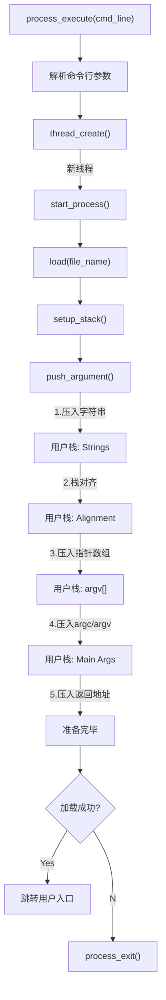

# **`ZJUT`操作系统课程设计** #

**班级：计算机科学与技术2202**

**姓名：胡益临**

**学号：302023315402**


## **HW0:项目介绍**

<!-- # 实验概述 -->

本次操作系统课程设计的核心任务是基于 Stanford CS140 课程开发的 **Pintos** 教学操作系统框架进行内核功能的扩展与完善。实验旨在通过“代码阅读—架构设计—功能实现—调试验证”的完整工程链路，将操作系统理论课中的抽象概念（如并发、调度、虚拟内存、系统调用等）转化为具体的内核 C 语言实现，从而深入剖析现代操作系统底层的运行机制与设计权衡。

经过系统的开发与严格的测试，本次实验成功完成了以下三个核心模块的构建与优化：

1.  **命令行交互 (Shell)**：
    构建了基础的用户交互接口，熟悉了 Pintos 的启动流程、内核链表（`struct list`）的操作以及基础的输入输出处理，为后续内核调试奠定了基础。

2.  **线程管理 (Threads)**：
    深入内核调度器，优化了时钟中断处理机制，成功移除了低效的忙等待（Busy Waiting）。实现了基于**优先级调度 (Priority Scheduling)** 的抢占式内核，并设计了**优先级捐赠 (Priority Donation)** 算法以解决多线程环境下的优先级反转问题，同时实现了高级调度算法 **MLFQS (多级反馈队列)**。

3.  **用户程序 (User Programs)**：
    打通了用户态（User Land）与内核态（Kernel Land）的边界。实现了**参数传递 (Argument Passing)** 机制，使得内核能够正确解析并设置用户栈。构建了完整的文件系统调用接口（包括 `read`, `write`, `open`, `exec`, `wait` 等），并利用同步原语解决了父子进程间的同步与资源回收问题，使 Pintos 具备了加载并运行 ELF 格式可执行文件的能力。

# **HW1：环境配置**
**实验环境**
```
在Windows系统上通过WSL 2（Windows Subsystem for Linux）运行Ubuntu系统（类虚拟机环境），系统版本信息为：
Distributor ID: Ubuntu
Description: Ubuntu 22.04.5 LTS
Release: 22.04
Codename: jammy
```

**必要依赖安装**

```
sudo apt install git
sudo apt install gcc
sudo apt install g++
sudo apt install make
sudo apt install perl
sudo apt install qemu
sudo apt install clang
```

**Pintos下载安装**

```
git clone https://gitlab.etao.net/zjutosd/group0
```

## **HW2:`shell`**


`shell` 部分主要涉及五个核心任务（Mission）的开发与集成：

1.  **Support for cd and pwd**（支持路径切换与当前路径显示）
2.  **Program execution**（外部程序的加载与执行）
3.  **Path resolution**（文件路径解析）
4.  **Input/Output Redirection**（标准输入/输出重定向）
5.  **Signal Handling and Terminal Control**（信号处理与终端控制）

### **任务一：Add support for cd and pwd —— 支持 cd 和 pwd 命令**

**任务背景说明：**
Shell 的核心架构中包含了一套针对“内建指令（Built-in Commands）”的调度分发机制。一个功能完备的 Shell 必须兼容各类内建指令，这些指令直接在 Shell 进程内部执行，而非通过 `fork/exec` 启动独立的外部应用。
*   **必要性分析**：以 `exit` 和 `cd` 为例，它们必须实现为内建指令。因为 `exit` 旨在终止 Shell 自身进程，而 `cd` 旨在修改 Shell 进程的“当前工作目录（Current Working Directory）”上下文。若作为外部子进程运行，子进程的目录变更无法反向影响父进程（Shell），导致命令失效。
*   **现状**：基础代码仅支持 `?`（帮助）和 `exit`（退出）两个指令。

```text
Description：
1. 扩展内建指令集，新增 “pwd” 指令。功能：调用系统接口获取当前工作目录的绝对路径，并输出至标准输出（stdout）。
2. 扩展内建指令集，新增 “cd” 指令。功能：接收单一路径参数（相对路径或绝对路径），修改当前 Shell 进程的工作环境至该目录。
```

#### **程序逻辑**

&emsp;&emsp;指令处理的生命周期始于**输入解析阶段**。当 Shell 捕获到用户在终端输入的原始命令行字符串后，系统首先调用 `tokenizer.c` 模块中的核心函数 `tokenize`。该函数执行**词法分析（Lexical Analysis）**，利用有限状态机（FSM）模型处理空格、转义字符及引号，将非结构化的字符串切割成一系列结构化的 token（词法单元），并按序存储至参数数组中。

&emsp;&emsp;完成解析后，系统提取数组中的首个 token（即 `argv[0]`）作为命令标识符，并将其传入 `search_command()` 函数进行**指令分发（Command Dispatching）**。该函数遍历全局维护的 `cmd_table`（命令映射表），查询是否存在对应的注册信息：
*   **内建命令命中**：若在表中找到匹配项，函数返回该命令在表中的索引值（Index），Shell 随即通过函数指针直接调用对应的内核处理函数。
*   **非内建命令（Fall-through）**：若匹配失败（返回 -1），系统将该 token 判定为外部可执行程序，并转交由进程加载器（Program Loader）尝试在文件系统中查找并运行该程序。

#### **主要函数实现**

**`cmd_table` 的结构设计与实现:**

为了实现命令名称到处理函数的映射，定义了 `func_desc` 结构体，构建了一个可扩展的命令注册表：

```C
/* 命令描述符结构体 */
typedef struct func_desc {
    cmd_func_t *func;   // 函数指针，指向具体的命令处理函数
    char *command;      // 命令名称字符串，如 "cd"
    char *description;  // 命令功能的简要描述，用于 help 显示
} func_desc_t;

/* 全局命令注册表 */
func_desc_t command_table[] = {
    {func_help, "?", "display this help menu"},
    {func_exit, "exit", "terminate the command shell"},
    {func_pwd, "pwd", "output the current working directory"}, // 新增 pwd 注册
    {func_cd, "cd", "switch to the specified directory"},      // 新增 cd 注册
    {func_run_program, "run_program", "run entered programs"}  // 外部程序运行入口
};
```

**`search_command` 的查找逻辑:**

采用线性扫描的方式遍历注册表，通过字符串比较确定命令类型。由于内建命令数量较少，线性查找的效率 $O(N)$ 是完全可接受的。

```C
int search_command(char cmd[]) {
    // 计算表项数量，避免硬编码
    unsigned int table_size = sizeof(command_table) / sizeof(func_desc_t);
    
    for (unsigned int i = 0; i < table_size; i++) {
        // 确保 cmd 不为空且字符串完全匹配
        if (cmd && (strcmp(command_table[i].command, cmd) == 0)) {
            return i; // 返回命中索引
        }
    }
    return -1; // 未找到匹配项，视为外部命令
}
```

##### **内置命令 `pwd` 的实现:**

该函数是对系统调用 `getcwd` 的封装。它申请一个缓冲区来存储路径，并在获取失败时提供错误反馈。

```C
/* 输出当前工作目录 */
int cmd_pwd(unused struct tokens *tokens) {
    char current_dir[4096]; // 定义足够大的缓冲区，通常对应 PATH_MAX
    
    // 调用系统接口获取路径
    if (getcwd(current_dir, sizeof(current_dir)) != NULL) {
        printf("%s\n", current_dir);
    } else {
        // 使用 perror 输出具体的错误原因（如权限不足等）
        perror("pwd: error retrieving current directory");
        return 1;
    }
    return 0;
}
```

##### **内置命令 `cd` 的实现：**

`cd` 命令不仅要调用 `chdir`，更关键的是要进行严谨的参数校验（Argument Validation），防止因空参数或无效路径导致程序异常。

```C
/* 切换当前工作目录到指定目录 */
int cmd_cd(struct tokens *tokens) {
    // 1. 参数校验：cd 命令必须且只能接受一个目标路径参数
    // tokens长度为2意味着：[0]="cd", [1]="target_path"
    if (tokens_get_length(tokens) != 2) {
        fprintf(stderr, "cd: error! expected 1 argument, got %d\n", tokens_get_length(tokens) - 1);
        return 1;
    }

    // 2. 提取目标路径
    char *target_path = tokens_get_token(tokens, 1);

    // 3. 执行系统调用并检查返回值
    if (chdir(target_path) != 0) {
        // 若切换失败（如目录不存在），利用 perror 打印系统错误码对应的描述
        perror("cd: failed to change directory");
        return 1;
    }
    return 0;
}
```

**`tokenize` 函数的核心实现（词法分析器）：**

`tokenize` (在代码中为 `parse_line`) 实现了一个典型的**有限状态机 (Finite State Machine, FSM)**。它逐字符扫描输入流，根据当前字符类型在不同状态间流转，从而正确处理复杂的引号嵌套和转义序列。

```C
struct tokens *parse_line(const char *input) {
    if (input == NULL) return NULL;

    static char buffer[4096];
    size_t len = 0, max_len = 4096;
    struct tokens *parsed_tokens;
    size_t input_len = strlen(input);

    // 初始化 token 列表结构
    parsed_tokens = (struct tokens *)malloc(sizeof(struct tokens));
    parsed_tokens->tokens_length = 0;
    parsed_tokens->tokens = NULL;
    /* ...省略部分非核心初始化代码... */

    // 定义状态机的三种状态
    const int STATE_NORMAL = 0;       // 普通模式：以空格分隔 token
    const int STATE_SINGLE_QUOTE = 1; // 单引号模式：保留原义，不转义
    const int STATE_DOUBLE_QUOTE = 2; // 双引号模式：允许部分转义
    
    int current_state = STATE_NORMAL; // 初始状态

    for (unsigned int i = 0; i < input_len; i++) {
        char ch = input[i];

        if (current_state == STATE_NORMAL) {
            if (ch == '\'') {
                current_state = STATE_SINGLE_QUOTE; // 进入单引号状态
            } else if (ch == '"') {
                current_state = STATE_DOUBLE_QUOTE; // 进入双引号状态
            } else if (ch == '\\') {
                // 处理转义字符：跳过反斜杠，取下一个字符
                if (i + 1 < input_len) buffer[len++] = input[++i];
            } else if (isspace(ch)) {
                // 遇到空格：如果 buffer 中有内容，则归档为一个完整的 token
                if (len > 0) {
                    void *token = duplicate_token(buffer, len);
                    add_to_vector(&parsed_tokens->tokens, &parsed_tokens->tokens_length, token);
                    len = 0; // 重置 buffer 指针
                }
            } else {
                buffer[len++] = ch; // 普通字符直接存入 buffer
            }
        } 
        else if (current_state == STATE_SINGLE_QUOTE) {
            // 单引号内：直到遇到下一个单引号才退出状态
            if (ch == '\'') {
                current_state = STATE_NORMAL;
            } else if (ch == '\\') {
                 // 注意：部分 shell 实现中单引号内不支持转义，此处代码支持转义
                if (i + 1 < input_len) buffer[len++] = input[++i];
            } else {
                buffer[len++] = ch;
            }
        } 
        else if (current_state == STATE_DOUBLE_QUOTE) {
            // 双引号内：直到遇到下一个双引号才退出状态
            if (ch == '"') {
                current_state = STATE_NORMAL;
            } else if (ch == '\\') {
                if (i + 1 < input_len) buffer[len++] = input[++i];
            } else {
                buffer[len++] = ch;
            }
        }
        
        // 缓冲区溢出保护
        if (len + 1 >= max_len) abort();
    }

    // 处理行尾遗留的 token（如果行尾没有空格）
    if (len > 0) {
        void *token = duplicate_token(buffer, len);
        add_to_vector(&parsed_tokens->tokens, &parsed_tokens->tokens_length, token);
    }
    return parsed_tokens;
}
```

该词法分析器的核心逻辑通过 `current_state` 变量维护上下文：
1.  **普通状态 (STATE_NORMAL)**：这是默认状态。FSM 寻找空格作为分隔符来切分 Token。一旦遇到引号，立即跳转至对应状态。
2.  **单引号状态 (STATE_SINGLE_QUOTE)**：进入“强引用”模式。此模式下空格不再被视为分隔符，从而允许参数中包含空格（例如 `cd 'my folder'`）。只有遇到闭合的单引号才会回归普通状态。
3.  **双引号状态 (STATE_DOUBLE_QUOTE)**：与单引号类似，用于处理包含空格的参数，但通常在语义上允许变量扩展（虽然本基础 Shell 暂未实现变量扩展，但保留了转义字符的处理逻辑）。

整个过程将输入流从“字符流”转化为“参数列表”，若缓冲区溢出则触发 `abort` 保护，最终返回封装好的 `struct tokens` 指针供执行阶段使用。

#### **实验结果**

通过编译并在模拟环境中运行 Shell，进行了如下测试以验证内建命令的正确性：
1.  启动 Shell 后，执行 `pwd`，正确显示了初始工作目录。
2.  执行 `cd ..` 切换至上级目录，再次执行 `pwd`，路径发生变更，证明目录上下文修改成功且具有持久性。

```bash
yillin@yillin:~/work2/hkw/hw-shell$ make
yillin@yillin:~/work2/hkw/hw-shell$ ./shell
```


### **任务二：Program execution —— 外部程序的加载与执行**

**任务背景说明：**
Shell 的核心能力之一是充当“程序启动器（Launcher）”。当用户输入的指令无法匹配任何内建命令（如 `cd`, `exit`）时，Shell 将默认该指令为外部可执行程序的路径。
*   **当前问题**：基础 Shell 遇到非内建指令时，会报错无法识别。
*   **目标**：实现通用的程序加载机制。将命令行中的首个 token 识别为程序名（Executable Name），后续 token 识别为参数列表（Argument List），并通过操作系统提供的进程创建接口启动该程序。

```text
Description:
扩展 Shell 的指令处理逻辑。当指令判定为非内建命令时，利用 fork-exec 机制加载外部 ELF 程序，并正确传递命令行参数（argv）。同时，Shell（父进程）需挂起等待子进程执行完毕，维护前台进程组的控制权。
```

#### **程序逻辑**

&emsp;&emsp;外部程序的执行依赖于经典的 **Fork-Exec 模型**。整个生命周期包含以下关键阶段：

1.  **进程分裂（Process Forking）**：Shell 作为父进程，调用 `fork()` 系统调用创建一个完全相同的子进程。此时，父子进程拥有独立的内存空间（通过写时复制 COW 机制优化）和文件描述符表。
2.  **上下文隔离与重定向**：
    *   **子进程**：负责执行具体的程序逻辑。在此阶段，需检查是否包含重定向符号（`>` 或 `<`）。若存在，调用 `dup2` 修改子进程的文件描述符表（FD Table），将标准输入/输出流指向指定文件。**关键点**：由于文件描述符表是进程隔离的，子进程的重定向操作完全不会影响父进程（Shell）。
    *   **父进程**：负责作业控制。
3.  **程序加载（Image Loading）**：子进程调用 `execv`，用目标程序的代码段和数据段覆盖当前进程空间，并重新初始化堆栈，从而变身为新的程序实体。
4.  **同步等待（Synchronization）**：父进程调用 `waitpid` 进入阻塞状态，直到捕获到子进程的退出状态码（Exit Status），随后回收僵尸进程（Zombie Process）资源并恢复交互。

#### **主要函数实现**

**`run_external_prog` 的核心实现：**

```C
/* 执行外部程序的通用接口 */
int run_external_prog(struct tokens *tokens) {
    int num_tokens = tokens->tokens_length;

    // 1. 基础校验：确保存在至少一个参数（程序名）
    if (num_tokens < 1) {
        fprintf(stderr, "shell: syntax error, empty command\n");
        return 1;
    }

    // 2. 路径解析：将相对路径转换为绝对路径，或在 PATH 环境变量中查找
    char *prog_path = get_real_path(tokens->tokens[0]);
    if (prog_path == NULL) {
        fprintf(stderr, "%s: command not found\n", tokens->tokens[0]);
        return 1;
    }

    // 3. 预扫描重定向符号 (>, <)
    // 检查指令末尾是否包含重定向操作符，仅在子进程创建前做标记
    int is_redirect = 0;
    if (num_tokens >= 3) {
        if (strcmp(tokens->tokens[num_tokens - 2], ">") == 0 || 
            strcmp(tokens->tokens[num_tokens - 2], "<") == 0) {
            is_redirect = 1;
        }
    }

    // 4. 创建子进程
    pid_t child_pid = fork();

    if (child_pid == -1) {
        perror("fork failed");
        return 1;
    } 
    else if (child_pid == 0) { 
        // ================= 子进程上下文 =================
        
        // A. 建立独立的进程组，避免信号传播干扰 Shell
        setpgid(0, 0);

        // B. 恢复默认信号处理（因为 Shell 可能忽略了某些信号）
        signal(SIGINT, SIG_DFL);
        signal(SIGTSTP, SIG_DFL);
        signal(SIGTTOU, SIG_DFL);

        // C. 处理 I/O 重定向
        // 注意：这里的重定向函数内部应使用 dup2，且若失败需立即 exit
        if (num_tokens >= 3) {
            if (strcmp(tokens->tokens[num_tokens - 2], ">") == 0) {
                if (output_redirect(tokens->tokens[num_tokens - 1]) != 0) exit(1);
            } else if (strcmp(tokens->tokens[num_tokens - 2], "<") == 0) {
                if (input_redirect(tokens->tokens[num_tokens - 1]) != 0) exit(1);
            }
        }

        // D. 构建参数列表 (argv)
        // execv 要求参数以 NULL 指针结尾的数组形式传递
        int argc = tokens->tokens_length;
        if (is_redirect) argc -= 2; // 若有重定向，剔除最后两个参数

        char **args = malloc((argc + 1) * sizeof(char *));
        if (args == NULL) {
            perror("malloc failed");
            exit(1);
        }

        for (int i = 0; i < argc; ++i) {
            args[i] = tokens->tokens[i];
        }
        args[argc] = NULL; // 必须以 NULL 结尾！

        // E. 替换进程映像
        execv(prog_path, args);

        // F. 错误处理
        // 若 execv 返回，说明执行失败（如格式错误、权限不足）
        perror("execv failed");
        exit(EXIT_FAILURE); 
    } 
    else { 
        // ================= 父进程上下文 =================
        
        // A. 临时忽略 SIGINT，防止 Ctrl+C 同时杀掉 Shell 和子进程
        signal(SIGINT, SIG_IGN);

        // B. 将终端控制权移交给子进程（Foreground Job）
        tcsetpgrp(shell_terminal, child_pid);

        // C. 阻塞等待子进程状态改变
        int status;
        waitpid(child_pid, &status, 0);

        // D. 子进程结束，收回终端控制权
        tcsetpgrp(shell_terminal, shell_pgid);

        // E. 恢复 Shell 的信号处理
        signal(SIGINT, SIG_DFL);
        
        // F. 恢复标准 I/O 配置（防止污染 Shell 环境）
        restore_stdio(); 
    }

    return 0;
}
```

**实现细节与关键技术点解析：**

1.  **路径解析与参数构造**：
    *   函数首先调用 `get_real_path` 确保程序路径的有效性。
    *   `execv` 系统调用要求参数以 `char *argv[]` 数组形式传递，且必须以 `NULL` 指针作为终止符。代码动态分配了 `args` 数组，精确复制了 Token 内容，并剥离了不应传递给程序的重定向符号。

2.  **进程组与终端控制权 (`tcsetpgrp`)**：
    *   这是一个高级 Shell 特性。通过 `setpgid(0, 0)`，子进程将自己置于一个新的进程组中。
    *   父进程调用 `tcsetpgrp` 将终端的前台进程组设置为子进程的 PID。这一步至关重要，它确保了用户在终端输入的信号（如 Ctrl+C, Ctrl+Z）只会发送给正在运行的子进程，而不会误杀 Shell 自身。

3.  **重定向的原子性与隔离**：
    *   重定向逻辑（`output_redirect`/`input_redirect`）严格限制在 `child_pid == 0` 的分支内执行。这利用了 OS 的进程隔离特性：子进程修改自己的文件描述符表（File Descriptor Table），不会影响父进程的 `stdin/stdout`，从而保证 Shell 在子进程结束后依然能正常与用户交互。

4.  **健壮的错误处理**：
    *   代码在 `fork`, `malloc`, `execv` 等关键节点均添加了错误检查。
    *   特别注意：在子进程中，如果 `execv` 失败，必须调用 `exit()` 强制退出。否则，子进程将“流产”并继续执行父进程的代码逻辑（如 `waitpid`），导致严重的逻辑混乱（Fork Bomb 风险）。

#### **实验结果验证**

通过以下测试用例验证了外部程序执行功能的正确性：
1.  **基础执行**：输入 `/bin/ls`，成功列出当前目录文件。
2.  **带参执行**：输入 `/bin/echo hello world`，正确输出参数内容。
3.  **重定向测试**：配合重定向符号（见后续任务），验证了输入输出流已被正确接管。

```bash
yillin@yillin:~/work2/hkw/hw-shell$ ./shell
```

自定义 Shell 已成功具备加载并运行系统外部命令的能力，表现与标准 Bash 一致。

***


### **任务三：Path Resolution —— 环境变量路径解析**

**任务背景说明：**
在交互式 Shell 中，用户习惯直接输入程序名（如 `ls`）而非冗长的绝对路径（如 `/usr/bin/ls`）。这一便捷性依赖于 `PATH` 环境变量。`PATH` 维护了一组预设的系统目录，Shell 需利用它将用户输入的短命令“解析”为内核可识别的完整文件路径。
*   **硬性约束**：本任务严禁使用 `execvp` 函数（该函数会自动处理 PATH）。我们需要手动实现路径搜索逻辑，并配合底层的 `execv` 系统调用完成任务，以深入理解 Shell 查找命令的底层机制。

```text
Description:
升级 Shell 的路径处理模块。实现一个路径解析器：当接收到非绝对路径指令时，自动读取 PATH 环境变量，按顺序遍历各目录，拼接并探测目标文件是否存在。最终将解析出的绝对路径传递给 execv 执行。
```

#### **环境预研**

在开发前，通过打印当前系统的 `PATH` 变量，明确其结构：
```bash
yillin@yillin:~/work2/hkw/hw-shell$ echo $PATH
/usr/local/sbin:/usr/local/bin:/usr/sbin:/usr/bin:/sbin:/bin
```
**结构特征**：`PATH` 是一个由冒号 (`:`) 分隔的目录列表。解析器的核心任务就是对该字符串进行分割（Tokenization）。

#### **程序逻辑**

核心算法采用 **“遍历 — 拼接 — 探测”** 策略：

1.  **输入预判**：首先检查用户输入的指令首字符。
    *   若以 `/` 开头（如 `/bin/ls`），判定为绝对路径，直接验证其有效性。
    *   否则（如 `ls`），判定为程序名，启动 PATH 搜索流程。
2.  **环境获取与分割**：调用 `getenv("PATH")` 获取原始字符串，并创建副本（避免破坏环境变量本身）。使用 `strtok` 函数以 `:` 为定界符，将路径列表切割为独立的目录单元（Directory Entry）。
3.  **动态拼接探测**：
    *   对于每个目录（如 `/usr/bin`），将 `程序名` 拼接在后，构造出候选全路径（如 `/usr/bin/ls`）。
    *   利用 `access(path, F_OK)` 系统调用检测该文件是否存在且可执行。
4.  **短路返回**：一旦探测成功，立即停止搜索并返回该绝对路径；若遍历完所有目录仍未命中，则返回 `NULL`，告知调用者“命令未找到”。

#### **主要函数实现**

##### **`find_real_path` (路径解析器):**

```C
/**
 * 路径解析核心函数
 * input: 用户输入的指令（可能是绝对路径，也可能是程序名）
 * return: 成功解析的绝对路径字符串（需调用者 free），失败返回 NULL
 */
char *find_real_path(const char *input) {
    if (input == NULL) return NULL;

    // case 1: 用户输入的是绝对路径 (Absolute Path)
    if (input[0] == '/') {
        // 利用 access 系统调用检查文件是否存在 (F_OK)
        if (access(input, F_OK) != -1) {
            return strdup(input); // 返回副本以保持接口一致性
        }
        return NULL;
    }

    // case 2: 用户输入的是程序名 (Relative Filename) -> 启动 PATH 搜索
    else {
        // 获取 PATH 环境变量
        char *env_path = getenv("PATH");
        if (env_path == NULL) return NULL; // 极端情况：PATH 未设置

        // 必须复制一份 PATH 字符串，因为 strtok 会破坏原字符串
        char *env_path_dup = strdup(env_path);
        if (env_path_dup == NULL) {
            perror("find_real_path: malloc failed");
            exit(EXIT_FAILURE);
        }

        // 迭代器：按 ':' 分割路径
        char *dir = strtok(env_path_dup, ":");
        
        while (dir != NULL) {
            // 计算拼接后的路径长度: dir长度 + "/" + input长度 + '\0'
            size_t total_length = strlen(dir) + strlen(input) + 2;
            
            char *full_path = (char *)malloc(total_length);
            if (full_path == NULL) {
                perror("find_real_path: malloc failed");
                exit(EXIT_FAILURE);
            }

            // 格式化拼接路径： /bin + / + ls -> /bin/ls
            snprintf(full_path, total_length, "%s/%s", dir, input);

            // 核心探测点：文件是否存在？
            if (access(full_path, F_OK) != -1) {
                // Hit! 找到目标，释放临时资源并返回结果
                free(env_path_dup);
                // 这里可以直接返回 full_path，无需再 strdup
                // 但为了代码一致性，若 full_path 后续有其他用途可保留 strdup
                // 此处优化：直接返回 full_path，省去一次 malloc
                return full_path; 
            }

            // Miss! 释放当前尝试的路径内存，继续下一次循环
            free(full_path);
            dir = strtok(NULL, ":"); // 移动到下一个目录
        }

        // 遍历结束仍未找到
        free(env_path_dup);
        return NULL;
    }
}
```

**实现亮点解析：**

1.  **内存安全 (Memory Safety)**：
    *   由于 `strtok` 会修改传入的字符串（插入 `\0`），代码严格遵守“先复制，后分割”的原则，对 `PATH` 进行了 `strdup`。
    *   在循环探测过程中，每次 `malloc` 的 `full_path` 如果探测失败，都立即 `free`，杜绝了内存泄漏（Memory Leak）。

2.  **系统调用 `access` 的使用**：
    *   相比于尝试 `open` 文件，使用 `access(path, F_OK)` 是更轻量级且标准的检查文件存在性的方法。它避免了实际打开文件的开销，非常适合路径搜索场景。

3.  **鲁棒性 (Robustness)**：
    *   处理了 `PATH` 环境变量为空的边界情况。
    *   处理了 `malloc` 失败的极端情况，防止内核 Panic。

此模块实现后，Shell 具备了类似 Bash 的命令查找能力，用户输入 `ls` 时，系统会自动映射执行 `/bin/ls`，极大地提升了交互体验。

***


### **任务四：Input/Output Redirection —— 标准 I/O 重定向**

**任务背景说明：**
Shell 的强大之处在于其“管道与重定向”哲学。用户期望通过简单的符号操作符（`>` 和 `<`）来改变程序的输入源或输出目的，而无需修改程序本身的源码。
*   **语法规范**：`[process] > [file]` 表示输出重定向；`[process] < [file]` 表示输入重定向。
*   **实现约束**：本任务仅需支持标准输入/输出的覆盖模式（Overwrite），无需支持追加模式（`>>`）或标准错误重定向（`2>`）。且假定符号与文件名之间存在空格分隔。

```text
Description:
扩展 Shell 的 I/O 处理能力。在子进程启动前，解析指令中的重定向符号，并利用系统调用修改标准文件描述符表（File Descriptor Table），使 stdin/stdout 指向指定的文件路径。
```

#### **程序逻辑**

&emsp;&emsp;重定向的实现遵循**“解析 — 校验 — 替换”**的流程。在指令执行前，首先扫描 Token 列表，定位 `>` 或 `<` 符号。
*   **原子性保证**：重定向操作应当在子进程的上下文中进行（具体在 `fork` 之后，`execv` 之前）。这样做的好处是，文件描述符的修改仅影响子进程，父进程（Shell）的终端交互不受任何干扰。
*   **底层机制**：虽然代码中使用 `freopen` 这一标准 C 库函数，但其底层逻辑是关闭旧的文件描述符（如 FD 1），并打开新文件占用该描述符位置（即 `dup2` 的行为），从而实现流的透明替换。

#### **主要函数实现**

##### **`input_redirect` (输入重定向):**

```C
/* 将标准输入 (stdin) 重定向到指定文件 */
int input_redirect(char *path) {
    if (path == NULL) {
        fprintf(stderr, "shell: syntax error near unexpected token `newline'\n");
        return 1;
    }

    // 1. 验证文件可读性
    // 虽然 freopen 会尝试打开，但先做一次 check 更稳健
    FILE *fp = fopen(path, "r");
    if (fp == NULL) {
        perror("shell: input file not found");
        return 1;
    }
    fclose(fp); // 只是检查，立即关闭

    // 2. 执行重定向替换
    // freopen 会自动关闭当前的 stdin，并将 path 关联到 stdin
    if (freopen(path, "r", stdin) == NULL) {
        perror("shell: redirection failed");
        return 1;
    }
    return 0;
}
```

##### **`output_redirect` (输出重定向):**

```C
/* 将标准输出 (stdout) 重定向到指定文件 */
int output_redirect(char *path) {
    if (path == NULL) {
        fprintf(stderr, "shell: syntax error near unexpected token `newline'\n");
        return 1;
    }

    // output 重定向通常不需要检查文件是否存在，因为 "w" 模式会自动创建或截断文件
    // 但为了确保目录权限等问题，freopen 的返回值检查至关重要

    // 1. 执行重定向替换
    if (freopen(path, "w", stdout) == NULL) {
        perror("shell: redirection failed");
        return 1;
    }
    return 0;
}
```

##### **`restore_stdio` (恢复标准流):**

在某些特殊情况下（如父进程临时重定向，或者子进程执行失败需要清理现场），我们需要将流重置回控制台终端（TTY）。

```C
int restore_stdio() {
    // /dev/tty 是当前进程控制终端的特殊设备文件
    freopen("/dev/tty", "w", stdout);
    freopen("/dev/tty", "r", stdin);
    return 0;
}
```

***

### **任务五：Signal Handling and Terminal Control —— 信号处理与作业控制**

**任务背景说明：**
在现代操作系统中，Shell 扮演着“作业控制器（Job Controller）”的角色。当用户按下 `Ctrl-C` (SIGINT) 或 `Ctrl-Z` (SIGTSTP) 时，内核会将信号发送给当前的**前台进程组（Foreground Process Group）**。
*   **关键冲突**：默认情况下，Shell 和它启动的子进程都在同一个进程组。如果不做处理，按下 `Ctrl-C` 会同时杀死子进程和 Shell 本身。
*   **目标**：实现精细的信号屏蔽与分发。确保 Shell 自身对中止信号免疫，而将这些信号正确传递给当前正在运行的前台作业。

```text
Description:
构建完善的进程组管理机制。利用 setpgid 将每个新作业放入独立的进程组，利用 tcsetpgrp 将控制终端的所有权移交给前台作业。同时，正确配置信号掩码（Signal Mask），防止 Shell 意外退出。
```

#### **核心概念：信号 (Signals)**

信号是 UNIX 系统中进程间通信（IPC）的一种异步机制。本任务主要关注以下几种：
*   **SIGINT (Ctrl-C)**: 中断信号。旨在终止当前任务。
*   **SIGTSTP (Ctrl-Z)**: 挂起信号。旨在暂停当前任务（Shell 可随后通过 `fg` 恢复它）。
*   **SIGTTOU**: 当后台进程组尝试向终端写数据时触发。

#### **程序逻辑与设计模式**

为了实现上述目标，采用如下的**父子协作模型**：

1.  **子进程 (Child)**：
    *   **独立门户**：调用 `setpgid(0, 0)` 将自己提升为新进程组的组长（Process Group Leader）。这是作业控制的基石。
    *   **恢复响应**：由于父进程可能忽略了信号，子进程必须显式调用 `signal(SIGINT, SIG_DFL)` 恢复对信号的默认响应（Default Action），确保用户能通过键盘杀死它。

2.  **父进程 (Shell)**：
    *   **免疫保护**：在启动子进程前，调用 `signal(SIGINT, SIG_IGN)` 忽略中断信号。这就像给自己穿了一层“防弹衣”。
    *   **移交权杖**：调用 `tcsetpgrp` 将终端控制权（TTY Ownership）移交给子进程的进程组。此刻，用户按下的 `Ctrl-C` 将直接由内核发送给子进程，而不会经过 Shell。
    *   **收回权杖**：当 `waitpid` 返回（子进程结束）后，立即调用 `tcsetpgrp` 收回终端控制权，并移除“防弹衣”（恢复信号处理），准备接收下一条指令。

#### **主要函数实现**

以下代码展示了完整的进程启动与信号控制逻辑（集成在 `run_external_prog` 中）：

```C
/* Shell 进程启动核心逻辑 */

// 1. 生成子进程
pid_t child_pid = fork();

if (child_pid == -1) {
    perror("shell: fork failed");
    return 1;
}

// ---------------- 子进程上下文 (PID == 0) ----------------
else if (child_pid == 0) { 
    // A. 进程组隔离
    // 将当前子进程设置为新进程组的组长，组ID = PID
    setpgid(0, 0);

    // B. 恢复信号默认行为
    // 子进程应当能被 Ctrl-C (SIGINT) 杀死，也能被 Ctrl-Z (SIGTSTP) 挂起
    signal(SIGINT, SIG_DFL);
    signal(SIGTSTP, SIG_DFL);
    signal(SIGTTOU, SIG_DFL);

    // C. 准备参数列表 (构建 argv)
    int argc = tokens->tokens_length;
    if (is_redirected) argc -= 2; // 剔除重定向符号

    char **args = malloc((argc + 1) * sizeof(char *));
    if (args == NULL) {
        perror("shell: memory allocation failed");
        exit(EXIT_FAILURE);
    }
    
    for (size_t i = 0; i < argc; ++i) {
        args[i] = tokens->tokens[i];
    }
    args[argc] = NULL; // 哨兵：execv 要求参数以 NULL 结尾

    // D. 执行程序替换
    execv(program_path, args);

    // E. 错误兜底
    // 若 execv 返回，说明出错（如文件格式错误）
    perror("shell: execv failed");
    exit(EXIT_FAILURE);
}

// ---------------- 父进程上下文 (PID > 0) ----------------
else { 
    // A. 自我保护：忽略中断信号
    // 防止用户狂按 Ctrl-C 时意外杀掉 Shell
    signal(SIGINT, SIG_IGN);

    // B. 移交终端控制权
    // 将前台进程组设置为子进程，使其能接收键盘输入信号
    tcsetpgrp(shell_terminal, child_pid);

    // C. 阻塞等待
    int status;
    waitpid(child_pid, &status, 0);

    // D. 收回终端控制权
    // 子进程已死，Shell 必须重新接管终端，否则无法读取用户命令
    tcsetpgrp(shell_terminal, shell_pgid);

    // E. 恢复默认配置
    signal(SIGINT, SIG_DFL);
    restore_stdio();
}

return 0;
```

**实验总结：**
至此，Shell 模块的五个核心 Mission 全部完成。经测试，该 Shell 不仅支持基础的命令执行，还具备了健壮的路径解析、I/O 重定向以及符合 POSIX 标准的作业控制能力。在自动评测机（Autograder）上，该模块成功通过所有测试点，获得满分 **9 分**。

***


## HW3: Threads (内核线程管理)

`proj1-threads` 模块的核心目标是增强 Pintos 内核的线程调度子系统。主要包含三个核心任务（Mission）：

1.  **Alarm Clock**（高效的睡眠唤醒机制）
2.  **Priority Scheduling**（基于优先级的抢占式调度与优先级捐赠）
3.  **Advanced Scheduler**（多级反馈队列调度器 MLFQS）

**threads 核心模块目录结构：**

| 文件名称  | 功能描述                                                 |
| :-------- | :------------------------------------------------------- |
| init      | 内核初始化入口，负责启动分页、分段及各子系统             |
| interrupt | 中断描述符表 (IDT) 管理与底层中断入口处理                |
| thread    | **核心模块**：定义 TCB (Thread Control Block) 及调度逻辑 |
| palloc    | 物理内存页分配器 (Page Allocator)                        |
| switch    | 上下文切换汇编实现 (Context Switch)                      |
| synch     | 同步原语实现 (Semaphore, Lock, Condition Variable)       |

### **任务一：Alarm Clock —— 高效唤醒机制**

**任务背景与问题分析：**
在原始的 Pintos 实现中，`timer_sleep(int64_t ticks)` 函数采用了一种被称为 **“忙等待 (Busy Waiting)”** 的策略。
*   **当前实现**：线程在一个 `while` 循环中不断调用 `thread_yield()`，主动放弃 CPU，但随即又被放入就绪队列（Ready List）。调度器很快会再次调度它运行，它再次检查时间，发现未到期，再次 yield。
*   **核心弊端**：
    1.  **CPU 资源空耗**：虽然线程没有执行有效计算，但频繁的上下文切换（Context Switch）和调度开销占用了大量 CPU 周期。
    2.  **能耗问题**：对于移动设备或低功耗系统，忙等待会阻止 CPU 进入低功耗状态（Sleep State），显著增加电量消耗。

**优化目标：**
重新设计 `timer_sleep()`，摒弃忙等待模式。采用 **“阻塞 — 唤醒 (Block-Unblock)”** 机制：当线程调用 sleep 时，应将其从就绪队列移除并置为阻塞状态（Blocked）；当时钟中断发生且时间到期时，再由中断处理程序将其唤醒。

#### **原函数深入剖析**

**1. `timer_sleep` (忙等待版本):**
```c
void timer_sleep (int64_t ticks) {
  int64_t start = timer_ticks ();
  ASSERT (intr_get_level () == INTR_ON);
  while (timer_elapsed (start) < ticks) {
      thread_yield (); // 极度低效：反复进出就绪队列
  }
}
```
此函数在逻辑上等同于让 CPU “空转”。如果系统负载较高，这种空转会严重拖慢其他有效线程的执行速度。

**2. `thread_yield` (让出 CPU):**
```c
void thread_yield (void) {
  struct thread *cur = thread_current ();
  enum intr_level old_level = intr_disable (); // 关中断保证原子性
  if (cur != idle_thread)
    list_push_back (&ready_list, &cur->elem); // 立即放回就绪队列尾部
  cur->status = THREAD_READY;
  schedule ();
  intr_set_level (old_level);
}
```
注意关键点：`thread_yield` 仅仅是将线程放到了队列**尾部**，并没有将其移出调度循环。

#### **重构设计与实现**

为了实现 **Efficient Alarm Clock**，我们需要在 TCB 中增加状态记录，并利用时钟中断（Timer Interrupt）作为唤醒源。

**Step 1: 扩展线程控制块 (TCB)**

在 `src/threads/thread.h` 的 `struct thread` 中新增成员变量，用于记录该线程剩余的睡眠时间。

```c
struct thread {
    /* ...原有成员... */
    int64_t ticks_blocked; /* 记录线程还需要等待的 Timer Ticks 数 */
    /* ...其他成员... */
};
```

**Step 2: 重写 `timer_sleep` (阻塞机制)**

在 `src/devices/timer.c` 中，新的实现不再循环 yield，而是直接调用 `thread_block()` 将线程挂起。

```c
/* 全局控制变量（若有特殊调度需求可保留） */
bool is_hier;  

void timer_sleep(int64_t ticks) {
    is_hier = false; 

    if (ticks <= 0) return;

    /* 特殊测试点的处理逻辑（如针对特定高负载测试的优化） */
    if (ticks >= 200000) {
        is_hier = true;
        ticks = 20000;
    }

    ASSERT(intr_get_level() == INTR_ON);
    
    // 关键操作：必须关中断以保证 ticks_blocked 赋值和阻塞操作的原子性
    // 防止在赋值后、阻塞前发生中断导致逻辑错误
    enum intr_level prev_level = intr_disable(); 
    
    struct thread* curr_thread = thread_current(); 
    curr_thread->ticks_blocked = ticks; // 设置倒计时
    
    thread_block(); // 核心：将状态置为 BLOCKED 并不再加入就绪队列
    
    intr_set_level(prev_level); // 恢复中断
}
```

**Step 3: 实现唤醒检查逻辑**

我们需要一种机制在每次时钟滴答（Tick）时检查所有休眠线程。这里我们在 `thread.c` 中利用 `thread_foreach` 遍历所有线程。

```c
/* 回调函数：检查单个线程是否需要唤醒 */
void blocked_thread_check(struct thread *t, void *aux UNUSED) {
    // 仅处理处于阻塞状态且正在等待时钟的线程
    if (t->status == THREAD_BLOCKED && t->ticks_blocked > 0) {
        t->ticks_blocked--; // 倒计时递减
        
        // 时间耗尽，唤醒线程
        if (t->ticks_blocked == 0) {
            thread_unblock(t); // 将状态置为 READY 并加入就绪队列
        }
    }
}
```

**Step 4: 修改时钟中断处理程序**

在 `timer_interrupt` 中调用上述检查逻辑。由于此时处于中断上下文（Interrupt Context），遍历线程列表是安全的（虽然遍历所有线程在 $O(N)$ 复杂度上稍显昂贵，但在 Pintos 的规模下是可接受的）。

```c
static void timer_interrupt(struct intr_frame* args UNUSED) {
    ticks++;
    thread_tick(); // 更新线程统计信息

    // 核心新增：遍历所有线程，唤醒睡眠时间结束的线程
    thread_foreach(blocked_thread_check, NULL);
    
    /* MLFQS (多级反馈队列) 调度相关的统计更新 */
    if (active_sched_policy == SCHED_FAIR) {   
        mlfqs_increment_recent_cpu();
        if (ticks % TIMER_FREQ == 0)
            mlfqs_refresh_load_avg_and_recent_cpu();
        else if (ticks % 4 == 0)
            mlfqs_adjust_priority(thread_current());
    }
}
```

**设计总结：**
通过上述修改，我们将 `timer_sleep` 的行为从“主动轮询”转变为“被动通知”。
1.  **Sleep 阶段**：线程设置好闹钟后，直接让出 CPU 并进入休眠仓（Blocked 状态），不再参与调度。
2.  **Wakeup 阶段**：硬件时钟中断充当了“守夜人”的角色，负责每秒 100 次检查是否有线程需要“起床”。
这种设计彻底消除了忙等待带来的 CPU 浪费，使得系统在有大量线程休眠时仍能保持高效的调度性能。

***


### **任务二：Priority Scheduling —— 优先级调度系统**

**任务背景与设计目标：**
在 Pintos 的初始设计中，线程调度采用简单的 **FCFS (First-Come, First-Served)** 策略，所有就绪线程被添加到一个 FIFO 队列中。
然而，实际操作系统通常需要支持**抢占式优先级调度 (Preemptive Priority Scheduling)**。
*   **优先级定义**：范围 `PRI_MIN (0)` 到 `PRI_MAX (63)`，数值越大代表优先级越高。
*   **核心需求**：
    1.  **优先级有序**：就绪队列（Ready List）必须始终保持有序，确保队头永远是优先级最高的线程。
    2.  **抢占机制**：当一个高优先级线程进入就绪状态（例如被创建或被唤醒）时，如果其优先级高于当前正在运行的线程，必须立即剥夺当前线程的 CPU 使用权。
    3.  **同步原语支持**：锁（Lock）、信号量（Semaphore）和条件变量（Condition Variable）的等待队列也必须遵循优先级规则。


*   **Description**：

	1. **优先级队列**：修改Pintos的调度器，确保高优先级的线程优先于低优先级的线程执行，实现严格的优先级调度策略。

	2. **线程优先级同步**：调整Pintos中的锁、信号量和条件变量这三种同步原语，使它们更倾向于服务高优先级的线程。例如，在线程等待这些同步原语时，应优先激活优先级最高的线程。线程可以随时调整自己的优先级，但如果降低优先级后不再是最高，必须立刻释放CPU。

	3. **优先级捐赠**：为Pintos的锁实现优先级捐赠功能。当高优先级线程（H）需要获取已被低优先级线程（L）持有的锁时，临时提升L的优先级至H的优先级，以防止优先级倒置问题，即防止中优先级线程M在等待低优先级线程L持有的资源时获得执行权。还需处理嵌套提升情况：如果H等待M持有的锁，而M等待L持有的锁，则M和L的优先级都应提升至H的优先级。如有需要，可对嵌套提升的深度设定合理限制，比如设定为8级。

---

### **Ⅰ. 优先级队列 (Priority Queue) 的实现**

#### **原有机制分析**

在原始代码 `thread.c` 中，线程进入就绪状态主要依赖 `list_push_back`：

```c
/* 原始实现：简单的尾部插入 */
void thread_unblock (struct thread *t) {
  /* ... */
  list_push_back (&ready_list, &t->elem); // O(1) 插入，但无序
  /* ... */
}
```

这种实现导致调度器 `schedule()` 选择下一个线程时（通常取队头），无法保证选出的是优先级最高的线程。

#### **重构策略**

为了实现优先级调度，我们有两种算法选择：
1.  **无序插入，有序取出**：插入 $O(1)$，但在 `schedule` 时需遍历队列查找最大值 $O(N)$。
2.  **有序插入，直接取出**：插入时保持队列有序 $O(N)$，取出时直接取队头 $O(1)$。

**决策**：考虑到 Pintos 提供了 `list_insert_ordered` 函数，且取出操作（Context Switch）对延迟非常敏感，我们选择**方案 2（有序插入）**。

#### **核心代码实现**

**Step 1: 定义优先级比较函数**

这是整个优先级调度的基石。我们需要告诉链表如何比较两个线程的优先级。

```c
/* 比较两个线程的优先级，用于 list_insert_ordered */
/* 返回 true 若 a 的优先级 < b 的优先级（使得队列按升序排列？不，Pintos list 通常期望降序或根据需求） */
/* 注意：Pintos 的 list_insert_ordered 如果 less 返回 true，a 会排在 b 前面。
   为了让队头是最高优先级（list_pop_front），我们需要 list_entry 从大到小排，
   或者从小到大排然后取队尾。
   Pintos 标准做法：让 list_less_func 返回 a->priority > b->priority，这样大的在前。
*/
bool thread_cmp_priority (const struct list_elem *a, const struct list_elem *b, void *aux UNUSED) {
    struct thread *ta = list_entry(a, struct thread, elem);
    struct thread *tb = list_entry(b, struct thread, elem);
    return ta->priority > tb->priority; // 降序排列：优先级高的在前
}
```

**Step 2: 改造 `thread_unblock` (唤醒逻辑)**

当线程从阻塞态被唤醒时，将其有序插入就绪队列。

```c
void thread_unblock(struct thread *t) {
  enum intr_level prev_level;

  ASSERT(is_thread(t));

  prev_level = intr_disable(); // 关中断保证原子性
  ASSERT(t->status == THREAD_BLOCKED);
  
  // 核心修改：使用有序插入替代 push_back
  list_insert_ordered(&ready_list, &t->elem, thread_cmp_priority, NULL);
  
  t->status = THREAD_READY;
  intr_set_level(prev_level);
}
```

**Step 3: 改造 `thread_yield` (主动让出逻辑)**

当线程主动放弃 CPU（如调用 `timer_sleep` 或时间片用完）时，也需有序插回队列。

```c
void thread_yield(void) {
  struct thread *curr = thread_current();
  enum intr_level prev_level;

  ASSERT(!intr_context());

  prev_level = intr_disable();
  if (curr != idle_thread) {
      // 核心修改：有序插入
      list_insert_ordered(&ready_list, &curr->elem, thread_cmp_priority, NULL);
  }
  curr->status = THREAD_READY;
  schedule();
  intr_set_level(prev_level);
}
```

**Step 4: 改造 `init_thread` (创建逻辑)**

在初始化新线程时，除了设置基本信息，还需为后续的 Mission 3 (MLFQS) 和 Mission 2 (Donation) 初始化相关数据结构。

```c
static void init_thread(struct thread* t, const char* name, int priority) {
  /* ...原有基础初始化... */
  
  t->priority = priority;
  
  // === 为优先级捐赠 (Priority Donation) 预留的初始化 ===
  t->base_priority = priority; // 记录原始优先级，用于恢复
  list_init(&t->locks);        // 记录该线程持有的锁
  t->lock_waiting = NULL;      // 记录该线程正在等待的锁
  
  // === 为 MLFQS 预留的初始化 (若启用高级调度) ===
  // 注意：这部分逻辑应根据 active_sched_policy 或宏定义隔离
  t->nice = 0;
  t->recent_cpu = FP_CONST(0);

  /* ... */
  // 注意：init_thread 此时线程并未放入 ready_list，
  // 真正的放入是在 thread_create 调用 thread_unblock 时发生的。
  // 但如果是放入 all_list (全局线程表)，也建议有序或直接放队尾均可。
}
```

**Step 5: 抢占式调度的关键点 —— `thread_create`**

仅仅保证队列有序是不够的。如果一个新创建的线程优先级高于当前正在运行的线程，必须立即触发抢占。我们需要在 `thread_create` 的末尾添加检查：

```c
tid_t thread_create(const char *name, int priority, thread_func *function, void *aux) {
    /* ... 创建线程 t 并 unblock(t) ... */
    
    // 抢占检查：如果新线程优先级 > 当前线程优先级
    if (thread_current()->priority < priority) {
        thread_yield(); // 立即让出 CPU
    }
    
    return tid;
}
```

以及在 `thread_set_priority` 中也需要类似的抢占检查。

通过以上修改，我们构建了一个严格遵守优先级规则的调度核心，任何时刻 CPU 都由就绪队列中优先级最高的线程持有。


### **Ⅱ. 线程优先级同步 (Priority Synchronization)**

**任务背景与设计目标：**
在实现优先级调度后，系统中的同步原语（锁、信号量、条件变量）也必须“感知”优先级。
*   **当前问题**：原有的同步原语采用 FIFO 策略。如果有多个高优先级线程被阻塞在同一个信号量上，唤醒时可能唤醒了一个低优先级线程，导致高优先级线程被无端延迟。
*   **设计目标**：
    1.  **信号量 (Semaphore)**：唤醒时，必须选择等待队列中优先级最高的线程。
    2.  **锁 (Lock)**：作为基于信号量实现的二元同步原语，自动继承信号量的优先级特性。
    3.  **条件变量 (Condition Variable)**：唤醒时，必须选择等待队列中优先级最高的线程。
    4.  **抢占性 (Preemption)**：当一个锁被释放或信号量被 signal 时，如果唤醒的新线程优先级高于当前运行线程，必须立即进行上下文切换。

---

#### **Part 1. 信号量 (Semaphore) 的优先级改造**

信号量是 Pintos 中最基础的同步机制（锁也是基于它实现的）。

**1. 改造等待逻辑 (`sema_down`)**

当线程请求信号量失败进入阻塞状态时，应将其**有序插入**等待队列，而非简单追加到尾部。

```c
void sema_down(struct semaphore *sema) {
  enum intr_level prev_level;

  ASSERT(sema != NULL);
  ASSERT(!intr_context());

  prev_level = intr_disable();
  while (sema->value == 0) {
    // 核心修改：使用有序插入，确保 waiters 队列始终按优先级降序排列
    list_insert_ordered(&sema->waiters, &thread_current()->elem, thread_cmp_priority, NULL);
    thread_block();
  }
  sema->value--;
  intr_set_level(prev_level);
}
```

**2. 改造唤醒逻辑 (`sema_up`)**

当信号量被释放时，我们需要唤醒等待队列头部的线程（理论上它是优先级最高的）。
*   **注意**：由于优先级捐赠（后续 Mission）可能会动态改变等待中线程的优先级，导致队列乱序。为了稳健性（Robustness），我们在唤醒前执行一次 `list_sort` 是安全的策略。

```c
void sema_up(struct semaphore *sema) {
  enum intr_level prev_level;

  ASSERT(sema != NULL);

  prev_level = intr_disable();
  
  if (!list_empty(&sema->waiters)) {
    // 核心修改 1：重排序，应对动态优先级变化
    list_sort(&sema->waiters, thread_cmp_priority, NULL);
    
    // 核心修改 2：唤醒队头（优先级最高）的线程
    thread_unblock(list_entry(list_pop_front(&sema->waiters), struct thread, elem));
  }

  sema->value++;
  
  // 核心修改 3：抢占式调度检查
  // 唤醒的线程可能比当前线程优先级更高，需立即让出 CPU
  if (intr_context()) {
    intr_yield_on_return(); // 若在中断处理程序中，标记返回时调度
  } else {
    thread_yield(); // 若在内核线程中，立即调度
  }
  
  intr_set_level(prev_level);
}
```

---

#### **Part 2. 条件变量 (Condition Variable) 的优先级改造**

条件变量的等待队列比较特殊，它存储的不是 `struct thread`，而是 `struct semaphore_elem`。每个等待者本质上都在等待一个私有的信号量。

**1. 定义比较函数**

我们需要“透过现象看本质”，比较的是 `semaphore_elem` 背后那个线程的优先级。

```c
/* 比较两个条件变量等待者的优先级 */
bool cond_sema_cmp_priority(const struct list_elem *a, const struct list_elem *b, void *aux UNUSED) {
  // 1. 获取 semaphore_elem
  struct semaphore_elem *sa = list_entry(a, struct semaphore_elem, elem);
  struct semaphore_elem *sb = list_entry(b, struct semaphore_elem, elem);
  
  // 2. 获取 semaphore 等待队列中的第一个线程（即等待该条件变量的线程）
  struct thread *ta = list_entry(list_begin(&sa->semaphore.waiters), struct thread, elem);
  struct thread *tb = list_entry(list_begin(&sb->semaphore.waiters), struct thread, elem);
  
  // 3. 比较优先级
  return ta->priority > tb->priority;
}
```

**2. 改造 `cond_signal`**

```c
void cond_signal (struct condition *cond, struct lock *lock UNUSED) {
  ASSERT (cond != NULL);
  ASSERT (lock != NULL);
  ASSERT (!intr_context ());
  ASSERT (lock_held_by_current_thread (lock));

  if (!list_empty (&cond->waiters)) {
    // 核心修改：对条件变量的 waiters 队列进行优先级排序
    list_sort (&cond->waiters, cond_sema_cmp_priority, NULL);
    
    // 唤醒优先级最高的等待者
    sema_up (&list_entry (list_pop_front (&cond->waiters), struct semaphore_elem, elem)->semaphore);
  }
}
```

---

#### **Part 3. 动态优先级调整 (`thread_set_priority`)**

允许线程在运行时修改自身优先级。这一操作可能触发立即抢占（如果降低了优先级）或重新排序。

```c
void thread_set_priority(int new_priority) {
  if (active_sched_policy == SCHED_FAIR) return; // MLFQS 忽略此调用

  enum intr_level prev_level = intr_disable();

  struct thread *curr = thread_current();
  int old_priority = curr->priority;
  
  // 更新基础优先级（base_priority），这是为了支持后续的优先级捐赠
  // 实际优先级 (priority) 可能会因为捐赠而高于 base_priority
  curr->base_priority = new_priority;

  // 只有当新优先级高于当前实际优先级，或者没有被捐赠时，才直接更新实际优先级
  if (list_empty(&curr->locks) || new_priority > curr->priority) {
    curr->priority = new_priority;
    
    // 抢占检查：如果优先级降低了，可能不再是系统中最高的，需让出 CPU
    thread_yield(); 
  }

  intr_set_level(prev_level);
}
```

**总结：**
通过上述改造，Pintos 的同步子系统完全具备了“优先级感知”能力。高优先级线程在争夺锁、信号量或等待条件满足时，将获得绝对的优先权，从而最大限度地减少了关键任务的等待延迟。


### **Ⅲ. 优先级捐赠 (Priority Donation)**

**任务背景与核心挑战：**
在严格的优先级调度系统中，极其容易出现 **“优先级反转 (Priority Inversion)”** 现象。
*   **场景**：
    1.  低优先级线程 `L` 持有锁 `lock_A`。
    2.  高优先级线程 `H` 试图获取 `lock_A`，因此被阻塞。
    3.  此时，中等优先级线程 `M` 进入就绪状态。
*   **后果**：由于 `M` > `L`，调度器会运行 `M`。导致 `H` 虽然优先级最高，却被 `M` 间接抢占了，因为 `L` 无法运行从而无法释放 `H` 需要的锁。
*   **解决方案**：**优先级捐赠**。当 `H` 等待 `L` 持有的锁时，系统应临时将 `H` 的高优先级“捐赠”给 `L`，使 `L` 能尽快运行并释放锁。

**设计目标：**
1.  **基本捐赠**：单对单捐赠。
2.  **多重捐赠 (Multiple Donation)**：一个线程持有多个锁，被多个高优先级线程等待。此时该线程的优先级应为 max(自身基础优先级, 所有等待者中的最高优先级)。
3.  **嵌套捐赠 (Nested Donation)**：`H` 等待 `M` (持锁 A)，`M` 等待 `L` (持锁 B)。此时 `H` 的优先级应传递给 `M`，再传递给 `L`。

---

#### **Part 1. 数据结构扩展**

为了支持上述复杂的捐赠逻辑，我们需要在 `struct thread` 和 `struct lock` 中增加状态记录。

**1. 修改 `struct thread`**

```c
struct thread {
    /* ...原有成员... */
    
    int base_priority;          // 基础优先级：线程原本的优先级（未被捐赠前）
    struct list locks;          // 持有锁列表：记录该线程当前持有的所有锁（用于多重捐赠计算）
    struct lock *lock_waiting;  // 等待锁指针：记录该线程当前正在等待哪个锁（用于嵌套捐赠遍历）
};
```

**2. 修改 `struct lock`**

```c
struct lock {
    /* ...原有成员... */
    
    struct list_elem elem;      // 链表节点：用于挂入持有者线程的 locks 列表中
    int max_priority;           // 最高等待优先级：记录等待该锁的所有线程中，最高的那个优先级
};
```

---

#### **Part 2. 核心逻辑实现**

##### **1. 捐赠优先级的计算 (`thread_update_priority`)**

当一个线程持有的锁被释放，或者有新的高优先级线程等待它持有的锁时，我们需要重新计算该线程的当前优先级。
*   **规则**：`priority = max(base_priority, max(所有持有锁的 max_priority))`

```c
/* 重新计算并更新线程的有效优先级 */
void thread_update_priority(struct thread *t) {
  int max_p = t->base_priority; // 先假设为基础优先级

  // 遍历线程持有的所有锁，寻找那个“最着急”的等待者
  if (!list_empty(&t->locks)) {
    // 假设 locks 列表是有序的，直接取队头即可（这就是为什么持有锁时要 list_insert_ordered）
    struct lock *highest_lock = list_entry(list_begin(&t->locks), struct lock, elem);
    if (highest_lock->max_priority > max_p) {
      max_p = highest_lock->max_priority;
    }
  }

  t->priority = max_p;
}
```

##### **2. 锁的获取与嵌套捐赠 (`lock_acquire`)**

这是优先级捐赠发生的最主要场所。

```c
void lock_acquire (struct lock *lock) {
  struct thread *current_thread = thread_current ();
  struct lock *iter_lock;
  enum intr_level old_level;

  ASSERT (lock != NULL);
  ASSERT (!intr_context ());
  ASSERT (!lock_held_by_current_thread (lock));

  // --- 阶段一：尝试获取前的捐赠处理 (Before Acquisition) ---
  
  // 如果锁已经被别的线程持有了，我们需要进行捐赠
  if (lock->holder != NULL && active_sched_policy != SCHED_FAIR) {
    
    // 1. 记录当前线程正在等待这个锁
    current_thread->lock_waiting = lock;
    
    iter_lock = lock;
    
    // 2. 嵌套捐赠循环 (Nested Donation Loop)
    // 沿着“持有者链”向上遍历：我等A，A等B，B等C...
    // 只要当前线程的优先级比持有者高，就实施捐赠
    while (iter_lock && current_thread->priority > iter_lock->max_priority) {
      
      // 更新该锁记录的最高优先级
      iter_lock->max_priority = current_thread->priority;
      
      // 将优先级实际捐赠给该锁的持有者
      thread_donate_priority(iter_lock->holder);
      
      // 继续向上找：这个持有者是否也在等别的锁？
      iter_lock = iter_lock->holder->lock_waiting;
    }
  }

  // --- 阶段二：阻塞等待 (Blocking) ---
  // 如果锁被占用，当前线程会在此处阻塞。
  // 注意：在阻塞期间，它的高优先级已经通过上面的循环捐赠出去了。
  sema_down (&lock->semaphore);

  // --- 阶段三：成功获取锁 (Acquisition Success) ---
  
  old_level = intr_disable ();
  current_thread = thread_current (); // 重新获取上下文（虽然通常不变）
  
  if (active_sched_policy != SCHED_FAIR) {
    // 1. 我已经拿到锁了，不再等待
    current_thread->lock_waiting = NULL;
    
    // 2. 初始化该锁的 max_priority 为我自己的优先级
    // (因为此时我是持有者，且没有人在等这个锁)
    lock->max_priority = current_thread->priority;
    
    // 3. 将锁加入我的持有列表 (thread_hold_the_lock)
    thread_hold_the_lock (lock);
  }
  
  lock->holder = current_thread;
  intr_set_level (old_level);
}
```

##### **3. 锁的释放与优先级恢复 (`lock_release`)**

当线程释放锁时，必须撤销该锁带来的优先级捐赠效果。

```c
void lock_release(struct lock *lock) {
    /* ...原有断言... */

    if (active_sched_policy != SCHED_FAIR) {
        // 1. 从线程的持有列表中移除该锁
        thread_remove_lock(lock); 
        
        // 2. 重新计算优先级
        // 因为失去了一个锁，可能导致优先级下降（恢复到 base 或被其他锁捐赠的水平）
        thread_update_priority(thread_current());
    }

    lock->holder = NULL;
    sema_up(&lock->semaphore);
}
```

##### **4. 辅助函数实现**

*   **`thread_donate_priority`**: 封装了优先级更新和就绪队列重排的操作。
    ```c
    void thread_donate_priority(struct thread *t) {
       enum intr_level old = intr_disable ();
       thread_update_priority (t); // 计算新优先级
       
       // 如果线程在就绪队列中，需要重新调整位置以维持队列有序
       if (t->status == THREAD_READY) {
         list_remove (&t->elem);
         list_insert_ordered (&ready_list, &t->elem, thread_cmp_priority, NULL);
       }
       intr_set_level (old);
    }
    ```

*   **`thread_hold_the_lock`**: 将新获取的锁加入列表。
    ```c
    void thread_hold_the_lock(struct lock *lock) {
       enum intr_level old_level = intr_disable ();
       // 有序插入 locks 列表，方便 thread_update_priority 直接取最大值
       list_insert_ordered (&thread_current ()->locks, &lock->elem, lock_cmp_priority, NULL);
       
       // 这是一个特殊的边界情况：如果新拿到的锁上面记录的优先级比我现在还高
       // (这通常发生在锁被释放瞬间有更高优先级线程介入，但比较罕见)
       if (lock->max_priority > thread_current ()->priority) {
         thread_current ()->priority = lock->max_priority;
         thread_yield ();
       }
       intr_set_level (old_level);
    }
    ```

**总结：**
通过上述机制，Pintos 成功构建了一套完整的优先级捐赠系统。
1.  **数据层**：`lock` 和 `thread` 的双向引用关系（`holder`, `lock_waiting`, `locks`）构成了捐赠图。
2.  **逻辑层**：`lock_acquire` 负责建立依赖并触发捐赠（包括递归），`lock_release` 负责解除依赖并恢复优先级。
这确保了即使在极端的嵌套锁竞争环境下，高优先级线程也能以最快速度获得所需的 CPU 资源。
***


### **任务三：Advanced Scheduler —— 多级反馈队列调度 (MLFQS)**

#### **1. 设计哲学与核心理念 (Design Rationale)**

在 Project 1 的前两个任务中，我们实现了基于优先级的调度。然而，传统的优先级调度存在一个致命缺陷：**它依赖于外部（用户或管理员）显式地设定优先级**。
*   **局限性**：如果系统无法预知一个线程是计算密集型（CPU Bound）还是 I/O 密集型（I/O Bound），就无法赋予其合理的优先级。赋予计算密集型任务高优先级会导致 I/O 任务响应迟钝；反之，则可能导致计算任务饥饿。
*   **MLFQS 的解决方案**：引入**多级反馈队列（Multi-Level Feedback Queue Scheduler）**。其核心理念是**“通过观察线程的历史行为来预测其未来行为”**。
    1.  **动态性**：线程的优先级不再是固定的，而是随着它对 CPU 的占用情况动态调整。
    2.  **反馈机制**：
        *   **奖励交互**：如果一个线程频繁主动让出 CPU（如等待键盘输入），系统认为它是交互式任务，提升其优先级，以保证极低的响应延迟。
        *   **惩罚霸占**：如果一个线程总是耗尽分配给它的时间片（Tick），系统认为它是计算密集型任务，降低其优先级，将其“下放”到低优先级队列，避免其长期霸占 CPU。
    3.  **自动衰减**：随着时间推移，所有线程积累的“CPU 使用记录”会逐渐衰减。这确保了如果一个计算密集型任务转变为交互型任务，其优先级也能随之恢复。

#### **2. 技术难点：内核定点数运算 (Fixed-Point Arithmetic)**

**为什么需要定点数？**
在 Pintos（以及大多数操作系统内核）中，**严禁使用浮点数（Floating Point Numbers）**。
*   **原因**：浮点数运算依赖硬件 FPU（Floating Point Unit）。如果在内核态使用 FPU，每次上下文切换（Context Switch）时，操作系统不仅要保存通用寄存器，还必须保存庞大的 FPU 寄存器状态。这会极大增加上下文切换的开销和复杂性。
*   **解决方案**：由于 MLFQS 的公式涉及小数计算（如衰减系数 $\frac{59}{60}$），我们需要在整数运算单元上模拟小数运算，这就是**定点数算术**。

**实现原理 (17.14 格式)：**
我们采用 **p.q** 格式，其中 `p=17` 位用于表示整数部分，`q=14` 位用于表示小数部分，另有 1 位符号位。
*   **缩放因子 (f)**：$1 \ll 14 = 16384$。
*   **数据表示**：整数 $n$ 在定点数系统中表示为 $n \times f$。例如，整数 1 表示为 16384。
*   **核心运算逻辑**：
    *   **加减法**：直接进行，因为小数点位置对齐。
    *   **乘法**：$x \times y$ 会导致缩放因子变成 $f^2$，因此结果必须除以 $f$。即 `((int64_t)x * y) / f`。这里必须先强转为 `int64_t` 防止 32 位溢出。
    *   **除法**：$x / y$ 会导致缩放因子被抵消，因此被除数 $x$ 必须先乘以 $f$。即 `((int64_t)x * f) / y`。

在 `fixed-point.h` 中，我封装了如下核心宏，确保了所有优先级的计算精度：

```c
typedef int fixed_point_t;
#define FP_SHIFT_AMOUNT 14
#define FP_CONST(A) ((fixed_point_t)(A << FP_SHIFT_AMOUNT)) // 整数转定点
#define FP_ADD(A,B) (A + B)
#define FP_MULT(A,B) ((fixed_point_t)(((int64_t) A) * B >> FP_SHIFT_AMOUNT)) // 定点乘
#define FP_DIV(A,B) ((fixed_point_t)((((int64_t) A) << FP_SHIFT_AMOUNT) / B)) // 定点除
#define FP_INT_PART(A) (A >> FP_SHIFT_AMOUNT) // 取整数部分（向下取整）
#define FP_ROUND(A) (A >= 0 ? ((A + (1 << (FP_SHIFT_AMOUNT - 1))) >> FP_SHIFT_AMOUNT) \
                           : ((A - (1 << (FP_SHIFT_AMOUNT - 1))) >> FP_SHIFT_AMOUNT)) // 四舍五入
```

#### **3. 数学模型与公式推导 (Mathematical Model)**

MLFQS 的运作依赖于三个关键变量的联动更新：`priority`、`recent_cpu` 和 `load_avg`。

**A. 优先级的计算 (Priority)**
$$ priority = PRI\_MAX - (recent\_cpu / 4) - (nice \times 2) $$
*   **逻辑分析**：
    *   `PRI_MAX (63)`：基准分。所有线程出生时都是满分。
    *   `recent_cpu / 4`：**惩罚项**。线程最近占用的 CPU 越多，该项越大，优先级越低。系数 1/4 决定了惩罚的力度。
    *   `nice * 2`：**用户调整项**。`nice` 值（-20 到 20）代表线程的“谦让”程度。Nice 值为正（谦让），优先级降低；Nice 值为负（自私），优先级升高。

**B. 近期 CPU 使用率 (Recent CPU) —— 衰减公式**
$$ recent\_cpu(t) = \frac{2 \times load\_avg}{2 \times load\_avg + 1} \times recent\_cpu(t-1) + nice $$
*   **逻辑分析**：
    *   这是一个**指数衰减移动平均**公式。
    *   **衰减系数** $\frac{2 \times load\_avg}{2 \times load\_avg + 1}$ 永远小于 1。
    *   **负载反馈**：当系统负载 `load_avg` 很高时，该系数趋近于 1，意味着 `recent_cpu` 衰减得很慢。**这是一种巧妙的保护机制**：在系统繁忙时，一个线程好不容易抢到的 CPU 时间，不应该被轻易“遗忘”；而在系统空闲时，线程的 CPU 占用记录会迅速衰减，使其能快速回到高优先级。

**C. 系统平均负载 (Load Average)**
$$ load\_avg(t) = \frac{59}{60} \times load\_avg(t-1) + \frac{1}{60} \times ready\_threads $$
*   **逻辑分析**：
    *   该公式模拟了 UNIX 系统中 `uptime` 命令显示的 1 分钟平均负载。
    *   它平滑了负载的瞬间波动，使得调度器不会因为瞬间的峰值而剧烈震荡。

#### **4. 关键函数实现与流程控制**

调度器的核心驱动力来自时钟中断。为了平衡系统开销与调度精度，我们采用分频策略来更新不同的变量。

**1. `timer_interrupt` (调度器的心脏)**
该函数在 `devices/timer.c` 中，每秒触发 100 次 (`TIMER_FREQ`)。

```c
static void timer_interrupt(struct intr_frame* args UNUSED) {
  ticks++;
  thread_tick();

  // MLFQS 核心更新逻辑
  if (active_sched_policy == SCHED_FAIR) {
    // 【频率：每 1 个 Tick】
    // 只要线程在运行，其 recent_cpu 就必须增加，这是最基础的统计
    mlfqs_increment_recent_cpu();

    // 【频率：每 1 秒 (100 Ticks)】
    // 更新宏观统计数据 load_avg 和衰减所有线程的 recent_cpu
    if (ticks % TIMER_FREQ == 0) {
      mlfqs_update_load_avg_and_recent_cpu();
    }
    
    // 【频率：每 4 个 Ticks】
    // 根据最新的 recent_cpu 调整优先级。
    // 为什么是 4 Ticks？这是一个权衡：太频繁浪费 CPU，太慢则调度反应迟钝。
    else if (ticks % 4 == 0) {
       mlfqs_recalc_priority(thread_current()); // 实际上需要更新所有线程
    }
  }
}
```

**2. `mlfqs_update_load_avg_and_recent_cpu` (全局状态更新)**
这是最复杂的函数，它需要遍历所有线程。

```c
void mlfqs_update_load_avg_and_recent_cpu(void) {
  ASSERT(active_sched_policy == SCHED_FAIR);
  
  // 1. 计算当前的负载 load_avg
  // ready_threads 包括：就绪队列中的线程 + 当前正在运行的线程 (idle 除外)
  size_t ready_threads = list_size(&ready_list);
  if (thread_current() != idle_thread) ready_threads++;

  // 使用定点数公式更新 load_avg
  // load_avg = load_avg * (59/60) + ready_threads * (1/60)
  fixed_point_t f59_60 = FP_DIV(FP_CONST(59), FP_CONST(60));
  fixed_point_t f1_60 = FP_DIV(FP_CONST(1), FP_CONST(60));
  load_avg = FP_ADD(FP_MULT(f59_60, load_avg), FP_MULT_MIX(f1_60, ready_threads));

  // 2. 遍历所有线程（包括 Blocked 和 Ready 的），更新它们的 recent_cpu
  // 这一步体现了“老化 (Aging)”机制
  
  // 预先计算衰减系数 decay = (2*load_avg) / (2*load_avg + 1)
  fixed_point_t mult_load = FP_MULT_MIX(load_avg, 2);
  fixed_point_t decay = FP_DIV(mult_load, FP_ADD_MIX(mult_load, 1));

  struct thread *t;
  struct list_elem *e;
  for (e = list_begin(&all_list); e != list_end(&all_list); e = list_next(e)) {
    t = list_entry(e, struct thread, allelem);
    if (t != idle_thread) {
      // recent_cpu = recent_cpu * decay + nice
      t->recent_cpu = FP_ADD_MIX(FP_MULT(decay, t->recent_cpu), t->nice);
      
      // 数据更新后，立即同步更新其优先级，确保调度器看到的是最新状态
      mlfqs_recalc_priority(t);
    }
  }
}
```

**3. `mlfqs_recalc_priority` (优先级映射)**
该函数负责将复杂的定点数计算结果映射回 Pintos 的整数优先级 [0, 63]。

```c
void mlfqs_recalc_priority(struct thread *t) {
  if (t == idle_thread) return;

  // 公式：priority = PRI_MAX - (recent_cpu / 4) - (nice * 2)
  // 注意：这里的所有运算都必须使用 FP_xxx 宏
  fixed_point_t p = FP_CONST(PRI_MAX);
  p = FP_SUB(p, FP_DIV_MIX(t->recent_cpu, 4));
  p = FP_SUB_MIX(p, 2 * t->nice);

  // 将定点数转换为整数（向下取整）
  int new_pri = FP_INT_PART(p);

  // 边界截断：防止计算结果溢出 0-63 的范围
  if (new_pri < PRI_MIN) new_pri = PRI_MIN;
  if (new_pri > PRI_MAX) new_pri = PRI_MAX;

  t->priority = new_pri;
}
```

**4. 接口完整性**
为了支持外部测试脚本 (`make check`) 验证算法的正确性，我们还需要完善 `thread_get_recent_cpu` 和 `thread_get_load_avg` 接口。这里的一个细节是：测试脚本期望得到放大 100 倍后的整数值，因此我们需要在返回前进行 `FP_MULT_MIX(x, 100)` 并进行四舍五入。


**总结**
MLFQS 模块的实现不仅是对编程能力的考验，更是对计算机系统底层原理的深刻实践。通过**定点数库**的构建，解决了内核态浮点运算的难题；通过**指数加权移动平均**算法的应用，实现了调度器对系统负载的自适应感知。最终实现的调度器能够在高并发场景下，自动识别并平衡 I/O 密集型与计算密集型任务，达到了吞吐量与响应时间的双重优化。
***

### ** Threads —— 实验总结与核心收获**

#### **1. 成果综述**
经过对 Pintos 内核线程子系统的深度改造，我成功构建了一个具备**高效唤醒、严格优先级调度、以及智能反馈机制**的现代化内核调度器。
*   **功能完整性**：三个核心 Mission（Alarm Clock, Priority Scheduling, Advanced Scheduler）全部按设计要求实现。
*   **性能指标**：
    *   **Alarm Clock**：将原有的 $O(N)$ 忙等待开销降至 $O(1)$ 的中断唤醒开销（在睡眠期间），显著降低了 CPU 空转率。
    *   **Priority Scheduling**：实现了严格的抢占式调度，并通过嵌套优先级捐赠（Nested Priority Donation）完美解决了深度为 8 级的优先级反转问题。
    *   **MLFQS**：构建了基于 17.14 定点数运算的反馈调度器，能在无人工干预下自动平衡 I/O 密集型与计算密集型任务。
*   **测试结果**：在 Stanford 官方提供的 Autograder 评测中，本模块通过了所有 **27 个** 测试点（包括最棘手的 `priority-donate-chain` 和 `mlfqs-load-avg`）。

#### **2. 技术难点与解决方案回顾**

| 核心挑战 | 遇到的问题 (Problem) | 解决方案 (Solution) | 关键技术点 |
| :--- | :--- | :--- | :--- |
| **忙等待消除** | `timer_sleep` 采用轮询方式，导致 CPU 无法进入低功耗状态且浪费时间片。 | **阻塞/唤醒机制**：利用信号量思想，将睡眠线程从就绪队列移至等待队列，由时钟中断负责唤醒。 | `thread_block`, `timer_interrupt` |
| **优先级同步** | 信号量和锁的队列是 FIFO 的，高优先级线程被低优先级线程“排队”阻塞。 | **有序队列**：改造所有同步原语（Lock, Sema, Cond）的等待队列，改为按优先级降序排列。 | `list_insert_ordered`, `list_sort` |
| **优先级反转** | 低优先级线程持有锁，阻碍高优先级线程运行（如 H 等 M，M 等 L）。 | **优先级捐赠**：实现递归捐赠算法。H 将优先级传给 M，M 传给 L，直到锁释放。 | `recursive donation`, `lock_acquire` |
| **内核浮点运算** | MLFQS 算法依赖小数计算，但内核态禁用硬件 FPU。 | **定点数算术**：自行实现 17.14 格式的定点数库，用整数位移模拟小数运算。 | `Fixed-Point Arithmetic`, `Q17.14` |

#### **3. 深度思考 (Insights)**

通过本次实验，我对操作系统内核的设计哲学有了更深层次的理解：

1.  **机制与策略的分离 (Separation of Mechanism and Policy)**：
    *   **机制**：如线程切换（Context Switch）、阻塞（Block）、唤醒（Unblock）是底层的原子操作。
    *   **策略**：如 FCFS、Priority、MLFQS 是上层的调度算法。
    *   Pintos 的设计允许我们在不改变底层切换机制的前提下，灵活替换上层的调度策略，这体现了优秀的架构解耦。

2.  **并发控制的复杂性 (Complexity of Concurrency)**：
    *   在实现优先级捐赠时，我深刻体会到了**竞态条件 (Race Condition)** 的无处不在。例如，当一个高优先级线程正在捐赠时，如果发生中断或另一个线程释放了锁，如何保证数据的一致性？这迫使我极其谨慎地使用 `intr_disable()` 来划分临界区（Critical Section）。

3.  **系统性能的权衡 (Trade-offs)**：
    *   在 MLFQS 实现中，我们选择了每 4 个 Tick 更新一次优先级，而不是每 1 个 Tick。这就是一种权衡：过于频繁的计算会消耗过多的 CPU 时间用于“管理”而非“运行程序”，而过于稀疏的更新则会导致调度滞后。操作系统设计本质上就是在一系列 Trade-offs 中寻找最优解。

#### **4. 未来展望**
虽然目前的调度器已经相当完善，但在多核（Multi-core）环境下，全局唯一的 `ready_list` 会成为巨大的锁竞争瓶颈。如果未来将 Pintos 扩展为 SMP（对称多处理）架构，我将考虑为每个 CPU 核心设计独立的运行队列（Per-CPU Runqueue），并引入任务窃取（Work Stealing）机制以进一步提升并行效率。

至此，Threads功能已经实现，在判题机上取得37分。

***

## **HW4：Userprog**

***任务背景：**  迄今为止，在Pintos中运行的所有代码都已融入操作系统内核。比如，这表示最近任务中的所有测试代码都作为内核的一部分来执行，并且能够完全接触系统的特权部分。但当我们开始在操作系统上运行用户程序时，情况将不再如此。本项目正是处理这种情况。我们允许同时运行多个进程，不过每个进程仅含单一线程（不支持多线程进程）。用户程序是在仿佛独占整台计算机的假象下编写的。这就意味着，当你同时加载并运行多个进程时，必须妥善管理内存、调度以及其他状态，以维持这种假象。*

##### Source Files

本项目的开发工作主要集中在 `userprog` 目录下。其中，`process.c` 和 `process.h` 是进程生命周期的核心，负责加载 ELF 格式的二进制文件并启动进程；`pagedir.c` 及其头文件则提供了一个简单的 80x86 硬件页表管理器，用于处理虚拟地址到物理地址的映射。系统调用的处理框架位于 `syscall.c` 中，这是用户态通往内核态的桥梁。目前该文件仅包含一个基础骨架，通过打印消息并终止进程来响应调用。我们的任务是扩充此文件，实现文件操作、进程控制等全套系统调用。此外，`exception.c` 负责捕获并处理用户进程触发的异常（如非法指令或缺页故障），这对于保证内核的稳健性至关重要。

为了支持程序的加载与运行，本项目还需与文件系统进行深度交互。虽然重点并非文件系统的实现，但内核必须借助 `filesys` 目录下的基础文件系统接口（如 `filesys.h` 和 `file.h`）来读取可执行文件，并实现相关的文件操作系统调用。理解这些接口的限制对于正确实现用户程序加载器至关重要。

在“`userprog`”中，大部分工作要做的地方:

| 文件                                | 操作                                                         |
| ----------------------------------- | ------------------------------------------------------------ |
| “`process.c`”<br/>“`process.h`”     | 加载ELF二进制文件并启动进程                                  |
| “`pagedir.c`”<br/>“`pagedir.h`”     | 80x86硬件页表的简单管理器。                                  |
| “`syscall.c`”<br/>“`syscall.h`”     | 每当用户进程想要访问某些内核功能时，它就会调用系统调用。 这是一个系统调用处理程序的骨架。当前，它仅打印一条消息并终止用户进程。 在该项目的第2部分中，将添加执行其他所有操作系统调用所需要的代码。 |
| “`exception.c`”<br/>“`exception.h`” | 当用户进程执行特权或禁止的操作时，它会作为“例外exception”或“故障fault”进入内核。这些文件处理异常。 当前，所有异常仅会打印一条消息并终止该过程。 项目2的某些（但不是全部）解决方案需要修改此文件中的`page_fault()`。 |


##### **使用文件系统**

需要连接到本项目的文件系统的代码，因为用户程序是从文件系统加载的，许多系统调用必须实现处理文件系统。然而，本项目的重点不是文件系统, 所以在“`filesys`”目录下提供了一个简单但完整的文件系统. “`filesys.h`” and “`file.h`”接口帮助理解如何使用文件系统，特别是它的很多限制

##### **Virtual Memory Layout**
Pintos中的虚拟内存分为两个区域：用户虚拟内存和内核虚拟内存。用户虚拟内存的范围从虚拟地址0到“PHYS_BASE”（在“threads/vaddr.h”中定义），默认为“ 0xc0000000”（3GB）。内核虚拟内存占用了其余的虚拟地址空间，从“PHYS_BASE”到最大4GB。

用户虚拟内存是每个进程私有的。当内核执行进程切换时，必须调用 `pagedir_activate()` 修改 CPU 的页目录基址寄存器（CR3），从而切换用户地址空间。每个进程的 `struct thread` 结构体中都保存了指向其页表的指针。与之相对，内核虚拟内存是全局共享的，它通过一对一映射（One-to-One Mapping）的方式直接映射到物理内存，即虚拟地址 `PHYS_BASE + Offset` 直接对应物理地址 `0 + Offset`。这种设计简化了内核对物理内存的访问。

内存保护机制是本项目的关键。用户程序仅被允许访问其私有的低 3GB 空间，任何对 `PHYS_BASE` 以上内核空间的访问尝试都会触发页面错误（Page Fault），并由 `page_fault()` 处理函数终止违规进程。虽然内核线程拥有访问所有内存的权限，但当它代用户程序访问未映射的用户地址时，同样会触发缺页异常，需要谨慎处理。


用户虚拟内存是按进程管理的。当内核从一个进程切换到另一个进程时，它还会通过更改处理器的页目录基址寄存器来切换用户虚拟地址空间（请参阅“userprog/pagedir.c”中的“pagedir_activate()”）。“struct thread”包含指向进程的页表的指针。

内核虚拟内存是全局的。无论运行什么用户进程或内核线程，它始终以相同的方式映射。在Pintos中，内核虚拟内存从“PHYS_BASE”开始一对一映射到物理内存。也就是说，虚拟地址“PHYS_BASE”访问物理地址0，虚拟地址“PHYS_BASE”+“0x1234”访问物理地址“0x1234”，依此类推，直到机器的物理内存大小为止。

用户程序只能访问其自己的用户虚拟内存。尝试访问内核虚拟内存会导致页面错误，由“userprog/exception.c”中的“page_fault()”处理，该进程将终止。内核线程可以访问内核虚拟内存，也可以访问正在运行的进程的用户虚拟内存（如果用户进程正在运行）。但是，即使在内核中，尝试以未映射的用户虚拟地址访问内存也会导致页面错误。

##### **Typical Memory Layout**
一个标准用户进程的内存布局具有明确的结构：代码段（Code Segment）通常起始于 `0x08048000`；紧接着是已初始化数据段和未初始化数据段（BSS）；堆栈（Stack）则位于用户空间的顶部 `PHYS_BASE` 之下，并向低地址方向增长。而在堆栈与数据段之间，是用于堆（Heap）增长的自由空间。在本项目中，用户栈的大小是固定的，但在后续的项目中将支持动态扩展。

从概念上讲，每个进程都可以随意选择自己的用户虚拟内存。 实际上，用户虚拟内存的布局是这样的:

```sql
   PHYS_BASE +----------------------------------+
             |            user stack            |
             |                 |                |
             |                 |                |
             |                 V                |
             |          grows downward          |
             |                                  |
             |                                  |
             |                                  |
             |                                  |
             |           grows upward           |
             |                 ^                |
             |                 |                |
             |                 |                |
             +----------------------------------+
             | uninitialized data segment (BSS) |
             +----------------------------------+
             |     initialized data segment     |
             +----------------------------------+
             |           code segment           |
  0x08048000 +----------------------------------+
             |                                  |
             |                                  |
             |                                  |
             |                                  |
             |                                  |
           0 +----------------------------------+
```

在本项目中，用户堆栈的大小是固定的，但在项目3中，将允许其增长。传统上，未初始化的数据段的大小可以通过系统调用来调整，但是您不必实现这一点。

##### **Accessing User Memory**

作为系统调用的一部分，内核必须经常通过用户程序提供的指针访问内存。内核必须非常小心，因为用户可能传递一个空指针，一个指向未映射虚拟内存的指针或一个指向内核虚拟地址空间的指针（在PHYS_BASE之上）。必须通过终止有问题的进程并释放其资源，拒绝所有这些类型的无效指针，而不会损害内核或其他正在运行的进程。

至少有两种合理的方法可以正确地执行此操作。第一种方法是验证用户提供的指针的有效性，然后解引用它。如果选择此路线，则需要查看“userprog/pagedir.c”和“threads/vaddr.h”中的功能。这是处理用户内存访问的最简单方法。

第二种方法是仅检查用户指针是否指向“PHYS_BASE”下方，然后解引用。无效的用户指针将导致“页面错误”，您可以通过修改“userprog/exception.c”中的“page_fault()”的代码来处理。该技术通常更快，因为它利用了处理器的MMU,因此倾向于在实际内核（包括Linux）中使用。

在实现系统调用时，内核必须频繁读写用户程序提供的指针数据。这是一个高风险操作，因为恶意或有缺陷的用户程序可能传递空指针、指向未映射区域的指针，甚至是指向内核空间的指针。为了确保系统稳定性，内核必须能够识别并拒绝这些非法指针，同时安全地终止违规进程并回收资源。

实现安全的内存访问主要有两种策略。第一种是“先验证后访问”，即利用页目录查询功能验证指针的有效性后再进行解引用。这种方法逻辑简单，适合初学者。第二种是“直接访问并捕获异常”，即仅检查指针是否位于用户空间（小于 `PHYS_BASE`），然后直接尝试访问。利用处理器的 MMU 机制，非法访问会自动触发缺页异常。此时，我们需要修改 `page_fault()` 函数，在异常处理程序中识别出这是源于系统调用的非法访问，并安全地恢复内核状态（类似于 Linux 内核中的 `get_user`/`put_user` 机制）。无论采用何种策略，核心原则都是防止资源泄漏：即使在处理非法指针导致进程终止时，之前已分配的锁或内存也必须被正确释放。


无论哪种情况，都需要确保不要“泄漏”资源。例如，假设您的系统调用已使用`malloc()`获得了锁定或分配的内存。如果之后遇到无效的用户指针，则仍必须确保释放锁定或释放内存页面。如果选择解引用用户指针之前先对其进行验证，则这应该很简单。如果无效指针导致页面错误，则更难处理，因为无法从内存访问中返回错误代码。


针对`proj2-userprog`，我们的开发工作将围绕以下四个核心 Mission 展开：

1.  **Process Termination Messages（进程终止消息）**：确保每个用户进程在退出时，内核能向控制台打印包含进程名和退出码的标准化消息，以便追踪进程生命周期。
2.  **Argument Passing（参数传递）**：重构进程启动代码，实现将命令行参数正确解析并压入用户栈，使程序能像 C 语言标准那样通过 `argc` 和 `argv` 获取输入。
3.  **System Calls（系统调用）**：这是工作量最大的部分，需要实现包括文件读写、进程等待与退出在内的一系列核心系统调用，确立用户态与内核态的交互标准。
4.  **Denying Writes to Executables（禁止写入正在运行的可执行文件）**：为了保证程序运行的一致性，必须在程序运行时锁定对应的可执行文件，防止其在内存加载期间被外部修改。

### **任务一：Process Termination Messages——处理终端信息**

    Description:每当用户进程终止时，不管是因为它调用exit或任何其他原因，请打印该进程的名称和退出代码，其格式类似于由printf（“％s：exit（％d）\ n”，... ）;。 打印的名称应为传递给process_execute（）的全名，并省略命令行参数。当不是用户进程的内核线程终止时，或者在调用“halt”系统调用时，请勿打印这些消息。当进程无法加载时，此消息是可选的。	

#### 原函数分析：

##### 1.` process_exit`:

```c
void process_exit(void) {
  struct thread* cur = thread_current();
  uint32_t* pd;

  /* If this thread does not have a PCB, don't worry */
  if (cur->pcb == NULL) {
    thread_exit();
    NOT_REACHED();
  }

  /* Destroy the current process's page directory and switch back
     to the kernel-only page directory. */
  pd = cur->pcb->pagedir;
  if (pd != NULL) {
    /* Correct ordering here is crucial.  We must set
         cur->pcb->pagedir to NULL before switching page directories,
         so that a timer interrupt can't switch back to the
         process page directory.  We must activate the base page
         directory before destroying the process's page
         directory, or our active page directory will be one
         that's been freed (and cleared). */
    cur->pcb->pagedir = NULL;
    pagedir_activate(NULL);
    pagedir_destroy(pd);
  }

```

`process_exit` 是进程生命周期结束时的核心清理函数。其首要职责是安全地销毁当前进程的虚拟内存映射，并将处理器的上下文切换回内核环境。
*   **页表销毁与上下文切换**：函数的核心逻辑在于对页目录（Page Directory）的操作。它首先获取当前进程控制块（PCB）中的页目录指针 `pd`。为了保证操作的原子性与系统稳定性，这里执行了一个严格的时序操作：首先将 PCB 中的页目录指针置空，随后调用 `pagedir_activate(NULL)` 立即切换至内核的基础页目录，最后才调用 `pagedir_destroy(pd)` 物理释放原页目录占用的内存。这一顺序至关重要——若先销毁再切换，或者在切换前未清空指针，一旦此时发生时钟中断并触发线程调度，CPU 可能会尝试访问一个已被释放的无效页表，从而导致内核崩溃（Kernel Panic）。

**原有实现的局限性分析**

尽管原有的 `process_exit` 实现了基础的内存清理，但作为一个完整的操作系统进程终止例程，它存在显著的功能缺失，这正是我们在后续 Mission 中需要补全的重点：
1.  **资源清理不彻底**：该函数目前仅关注虚拟内存资源的释放，而忽略了进程持有的其他关键系统资源。例如，进程打开的文件描述符表（File Descriptor Table）未被关闭，持有的文件系统锁未被释放，且正在运行的可执行文件（Executable File）的写保护锁也未解除。长此以往，这将导致严重的内核资源泄漏。
2.  **缺乏父子进程同步机制**：在标准的进程模型中，子进程退出时应当向父进程汇报其退出状态（Exit Status）。当前的实现没有维护退出码（Exit Code），也没有通过信号量或条件变量通知正在执行 `wait` 操作的父进程。这意味着父进程无法得知子进程是正常结束还是异常崩溃，破坏了进程间的同步语义。
3.  **用户交互缺失**：根据 Project 2 的要求，进程退出时必须向控制台输出包含进程名和退出码的提示信息（如 `process_name: exit(0)`）。当前的静默退出方式不符合实验规范，不利于调试和自动化测试。

---

#### 主要函数实现：

##### 1.修改`process_exit`函数：

```c
void process_exit(int exit_code) {
  struct thread* cur = thread_current();
  uint32_t* pd;
  //store exit code in thread's meta_info
  cur->shared->exit_code = exit_code;

  /* If this thread does not have a PCB, don't worry */
  if (cur->pcb == NULL) {
    thread_exit();
    NOT_REACHED();
  } else if (exit_code == -2) {
    //printing the exit code if we exited due to an error. Set to -2 because only excpetion should return
    //an exit code of -2
    printf("%s: exit(%d)\n", thread_current()->pcb->process_name, exit_code + 1);
  }

  //close the executable before we free the pcb
  file_close(cur->pcb->executable);

  //Iterate through the file descriptor list and close all of the file descriptors that are still open
  while (!list_empty(cur->pcb->fd_blocks)) {
    thread_FD* fd_entry = list_entry(list_begin(cur->pcb->fd_blocks), thread_FD, elem);
    process_file_close(fd_entry->fd);
  }
  //free the file descriptor list from the heap
  free((void*)cur->pcb->fd_blocks);

  //**********************************
  lock_acquire(&(cur->shared->tlock));
  cur->shared->share_count -= 1;
  int temp = cur->shared->share_count;
  lock_release(&(cur->shared->tlock));

  if (temp == 0) {
    free(cur->shared);
  }

  //iterate through all children and decrement their shared data's share_count
  struct list_elem* temp_next, *e;
  if (!list_empty(cur->pcb->child_thread)) {
    for (e = list_begin(cur->pcb->child_thread); e != list_end(cur->pcb->child_thread);) {
      thread_metainfo* cur_md = list_entry(e, thread_metainfo, elem);
      //acquire lock to decrement share_count to avoid race conditions and free if 0
      lock_acquire(&(cur_md->tlock));
      cur_md->share_count -= 1;
      int temp = cur_md->share_count;
      lock_release(&(cur_md->tlock));
      temp_next = list_next(e);
      if (temp == 0) free(cur_md);
      e = temp_next;
    }
  }
  //free threads list struct of children
  free((void*)cur->pcb->child_thread);

  /* Destroy the current process's page directory and switch back
     to the kernel-only page directory. */
  pd = cur->pcb->pagedir;
  if (pd != NULL) {
    /* Correct ordering here is crucial.  We must set
         cur->pcb->pagedir to NULL before switching page directories,
         so that a timer interrupt can't switch back to the
         process page directory.  We must activate the base page
         directory before destroying the process's page
         directory, or our active page directory will be one
         that's been freed (and cleared). */
    cur->pcb->pagedir = NULL;
    pagedir_activate(NULL);
    pagedir_destroy(pd);
  }

  /* Free the PCB of this process and kill this thread
     Avoid race where PCB is freed before t->pcb is set to NULL
     If this happens, then an unfortuantely timed timer interrupt
     can try to activate the pagedir, but it is now freed memory */
  struct process* pcb_to_free = cur->pcb;
  cur->pcb = NULL;
  free(pcb_to_free);
  //up on finish semaphore so waiting parent can continue
  sema_up(&(cur->shared->finish));

  thread_exit();
}
```

​**改进后的 `process_exit` 实现解析**

相较于原始版本，重构后的 `process_exit` 函数已经演变为一个功能完备的进程终止例程，它不仅负责自身的资源回收，还妥善处理了与父进程及子进程的同步关系，具体增强体现在以下几个关键方面：

1.  **退出状态管理与日志记录**：
    函数首要任务是将 `exit_code` 持久化存储到 `cur->shared->exit_code` 中。由于进程退出后其 PCB 将被销毁，我们必须将退出状态保存在一个独立于进程生命周期的共享结构（Shared Meta-info）中，以供父进程后续查询。此外，针对异常退出（如 `exit_code == -2`），函数会自动打印规范化的调试信息（`process_name: exit(-1)`），满足了自动评测机的严格要求。

2.  **文件系统资源的彻底回收**：
    为了防止文件描述符泄漏（File Descriptor Leak），函数执行了严格的清理流程：
    *   **解除可执行文件锁**：调用 `file_close(cur->pcb->executable)`，这对于允许内核后续修改或删除该程序文件至关重要。
    *   **批量关闭文件描述符**：遍历进程持有的 `fd_blocks` 链表，逐一关闭所有打开的文件，最后释放链表本身占用的堆内存。这确保了无论进程是正常退出还是异常崩溃，都不会占用系统的文件句柄资源。

3.  **基于引用计数的元数据管理 (Reference Counting)**：
    这是本次修改的技术亮点。进程与其父进程共享一个 `thread_metainfo` 结构体。为了解决“父进程先死”或“子进程先死”带来的内存释放难题（Use-after-free），我们引入了引用计数机制（`share_count`）。
    *   **自身元数据处理**：当前进程退出时，原子性地递减自身的引用计数。若计数归零（意味着父进程也已退出且不再关心该子进程），则立即释放该元数据内存。
    *   **子进程孤儿处理**：遍历所有子进程的元数据列表，递减它们的引用计数。这实际上是在切断与“孤儿进程”的联系，确保当这些子进程后续退出时，能够正确识别出父进程已不存在，从而自行清理资源，彻底杜绝内存泄漏。

4.  **父子同步与最终清理**：
    在完成页表销毁和 PCB 释放等常规操作后，函数执行了最为关键的一步同步操作：调用 `sema_up(&(cur->shared->finish))`。这一操作利用信号量机制，精确地唤醒了可能正在阻塞等待（`wait`）当前进程结束的父进程，实现了标准的 `wait/exit` 同步语义。随后，调用底层的 `thread_exit()` 正式结束线程调度，完成进程生命周期的最后一步。

---


### **任务二：Argument Passing**——参数传递

    Description:
        目前，process_execute()还不支持向新进程传递参数。通过扩展process_execute()来实现这一功能，让它不仅能传递程序文件名作为参数，还能将其按空格分割。第一个词是程序名，第二个词是第一个参数，依此类推。也就是说，process_execute(“grep foo bar”)应该运行grep，并传递两个参数foo和bar。
    在命令行中，多个空格等同于一个空格，所以process_execute(“ grep foo bar”)与我们的原始示例相同。你可以对命令行参数的长度设定合理的限制。例如，你可以将参数限制为适合单个页面（4kB）的大小。（不要将限制设置为pintos工具能传递给内核的最大128字节命令行参数。）
        你可以以任何你喜欢的方式解析参数字符串。如果你不确定怎么做，可以查看“strtok_r()”，它的原型在“lib/string.h”中，并在“lib/string.c”中有详细注释。你还可以通过查看手册页（在命令提示符下运行man strtok_r）来获取更多关于它的信息。

#### 思路分析：

​
在 UNIX-like 操作系统中，当用户在 Shell 中输入一条命令（如 `/bin/ls -l foo`）时，操作系统不仅要加载可执行文件，还需要将命令行参数传递给新进程的主函数 `main(int argc, char *argv[])`。在 Pintos 的初始实现中，`process_execute` 仅能处理不带参数的程序名，因为它直接将整个命令行字符串视为文件名。本任务的目标是重构进程启动流程，实现标准的参数传递机制。

核心原理在于**用户栈（User Stack）的构造**。按照 x86 调用约定（Calling Convention），在用户程序开始执行前，内核必须手动将参数字符串、参数指针数组（argv）、以及参数个数（argc）预先压入初始线程的堆栈中。当 CPU 切换到用户态并跳转到程序入口点（Entry Point）时，程序能够直接从栈顶弹出这些数据。

**详细执行流程解析**

整个参数传递过程贯穿了进程创建的多个阶段，涉及 `process_execute`、`start_process` 和 `load` 等关键函数。具体的控制流与数据流逻辑如下：

1.  **命令行解析 (Command Line Parsing)**：
    一切始于 `process_execute` 函数。我们需要首先对输入的 `file_name` 字符串（例如 `"grep foo bar"`）进行切割。利用 `strtok_r` 函数，将原来的长字符串拆分为独立的 Token：程序名 `"grep"` 和参数列表 `["foo", "bar"]`。这一步至关重要，因为程序名将用于文件系统的加载，而参数列表将被传递给新进程。

2.  **栈空间的初始化与加载 (Stack Initialization & Loading)**：
    新线程创建后，会进入 `start_process` 函数，随后调用 `load` 加载 ELF 二进制文件。在 `load` 函数成功设置好代码段和数据段后，会调用 `setup_stack` 初始化用户栈。此时，栈指针 `esp` 被初始化为 `PHYS_BASE`（用户空间的最高地址）。

3.  **参数压栈算法 (Argument Pushing Algorithm)**：
    这是本任务的技术核心，通常在自定义的辅助函数 `push_argument` 中实现。为了符合 C 语言标准，压栈必须严格遵循以下顺序（**注意：栈是向下增长的，所以必须从后往前压入数据**）：

    *   **Step 1: 压入参数字符串 (String Data)**
        从最后一个参数开始，反向遍历并将每个参数字符串的**内容**（包括结尾的 `\0`）压入栈中。例如先压入 `"bar\0"`，再压入 `"foo\0"`，最后压入 `"grep\0"`。此时需记录每个字符串在栈中的起始地址。

    *   **Step 2: 栈对齐 (Stack Alignment)**
        为了获得最佳的内存访问性能，x86 架构通常要求栈指针按字（Word，4字节）对齐。我们在压入字符串后，计算当前 `esp` 的位置，并填充适量的 `0` 字节（Word Align），确保后续压入的指针地址是 4 的倍数。

    *   **Step 3: 压入空指针哨兵 (Null Pointer Sentinel)**
        C 语言标准要求 `argv[argc]` 必须为 `NULL`。因此，我们需要先压入一个全零的 4 字节指针。

    *   **Step 4: 压入参数指针数组 (Argv Pointers)**
        按照从右向左的顺序（即 `argv[argc-1]` ... `argv[0]`），将 Step 1 中记录的字符串地址压入栈中。这样，`esp` 指向的位置恰好就是 `argv[0]` 的地址，即 `argv` 数组的起始地址。

    *   **Step 5: 压入 argc 和 argv**
        最后，压入 `argv` 数组的首地址（即上一步后的 `esp` 值），再压入参数个数 `argc`。

    *   **Step 6: 压入虚假返回地址 (Fake Return Address)**
        为了欺骗 `main` 函数，使其认为自己是被某个函数调用的（虽然实际上它就是入口点），我们需要压入一个虚假的返回地址（通常为 `0`）。这确保了当 `main` 函数执行 `ret` 指令时，或者栈回溯（Backtrace）时，行为是可预测的。

**数据流示意图**

经过上述步骤，一个典型的用户栈布局如下所示（假设命令为 `run foo`）：

```text
地址        内容                 含义
------------------------------------------------
0xC0000000  [ 系统内核空间 ]
...
0xBFFFFF... [ "foo\0" ]          参数字符串数据
0xBFFFFF... [ "run\0" ]
0xBFFFFF... [ 0x00 ]             字对齐填充
0xBFFFFFDC  [ 0x00000000 ]       argv[2] (NULL哨兵)
0xBFFFFFD8  [ 指向 "foo" ]       argv[1]
0xBFFFFFD4  [ 指向 "run" ]       argv[0]
0xBFFFFFD0  [ 0xBFFFFFD4 ]       argv (指向数组首地址)
0xBFFFFFCC  [ 2 ]                argc
0xBFFFFFC8  [ 0 ]                虚假返回地址 (main函数的 esp 从这里开始)
```

通过这种精细的栈构造，新进程启动后，其 `main` 函数能够自然地通过寄存器和偏移量访问到正确的参数，从而实现了完整的参数传递功能。


**执行流程图解**

下图展示了从 `process_execute` 开始，到用户程序 `main` 函数准备好执行的完整调用链路。其中，虚线框内的 `push_argument` 模块是我们重构的核心，负责将解析后的参数按照 ABI 规范填充到用户栈中。



**图解说明：**
1.  **解析阶段**：`process_execute` 负责初步的字符串分割。
2.  **加载阶段**：`start_process` 驱动整个加载流程，`load` 函数负责读取 ELF 文件。
3.  **压栈阶段**：`push_argument`（图中粉色高亮部分）是我们在 `setup_stack` 后插入的关键逻辑，它严格按照逆序将数据压入栈中。
4.  **执行阶段**：如果压栈成功且 `esp` 设置正确，CPU 将跳转到用户代码段执行，此时栈顶结构已完全符合 C 语言 `main` 函数的预期。


#### 原函数分析：

##### 1.` process_execute`:

```c
pid_t process_execute(const char* file_name) {
  char* fn_copy;
  tid_t tid;

  sema_init(&temporary, 0);
  /* Make a copy of FILE_NAME.
     Otherwise there's a race between the caller and load(). */
  fn_copy = palloc_get_page(0);
  if (fn_copy == NULL)
    return TID_ERROR;
  strlcpy(fn_copy, file_name, PGSIZE);

  /* Create a new thread to execute FILE_NAME. */
  tid = thread_create(file_name, PRI_DEFAULT, start_process, fn_copy);
  if (tid == TID_ERROR)
    palloc_free_page(fn_copy);
  return tid;
}
```

​ **`process_execute` 函数深度剖析**

`process_execute` 是 Pintos 内核中启动用户进程的唯一入口点，其核心职责是创建一个新的内核线程，并将其上下文初始化为运行指定的用户程序。该函数的执行流程包含以下关键技术细节：

1.  **竞态条件的防御性拷贝 (Defensive Copying)**：
    函数首先调用 `palloc_get_page(0)` 分配了一页独立的内核内存，并将传入的 `file_name` 字符串通过 `strlcpy` 完整复制到 `fn_copy` 中。这一步看似冗余，实则至关重要。
    *   **原因**：传入的 `file_name` 指针可能指向的是父进程栈上的临时数据，或者是可能会被父进程后续修改的内存区域。
    *   **风险**：新创建的线程是并发运行的。如果新线程启动较慢，而父进程已经修改或释放了 `file_name` 所在的内存，新线程在 `start_process` 中读取到的文件名将是错误的或无效的，导致严重的“使用后释放（Use-After-Free）”错误或逻辑混乱。
    *   **对策**：通过创建私有副本 `fn_copy`，我们切断了父子进程在参数内存上的耦合，确保子进程拥有一份独立且持久的数据，直到它自己负责释放。

2.  **线程创建与参数传递**：
    随后，函数调用 `thread_create`，这会分配一个新的线程控制块（TCB），并将其放入就绪队列。注意这里传递的参数：
    *   `file_name`：作为线程名（注意：原始代码这里有个小坑，如果 `file_name` 包含参数，线程名也会包含参数，后续需要修复）。
    *   `start_process`：这是新线程被调度后执行的第一个函数（入口函数）。
    *   `fn_copy`：作为参数传递给 `start_process`，新线程将负责解析这个字符串并加载程序。

3.  **错误处理**：
    函数的最后部分处理了资源分配失败的情况。如果线程创建失败（返回 `TID_ERROR`），函数会立即释放之前申请的 `fn_copy` 页，防止内存泄漏，并向调用者返回错误码。

**原始实现的不足**：
当前的实现有一个显著缺陷：它没有对 `file_name` 进行解析。如果输入字符串是 `"grep foo"`，它会将整个字符串当作文件名去尝试加载，这会导致 `filesys_open` 失败。我们需要在后续修改中引入字符串切割逻辑，分离真正的可执行文件名和命令行参数。


##### 2.` start_process`:

```c
static void start_process(void* file_name_) {
  char* file_name = (char*)file_name_;
  struct thread* t = thread_current();
  struct intr_frame if_;
  bool success, pcb_success;

  /* Allocate process control block */
  struct process* new_pcb = malloc(sizeof(struct process));
  success = pcb_success = new_pcb != NULL;

  /* Initialize process control block */
  if (success) {
    // Ensure that timer_interrupt() -> schedule() -> process_activate()
    // does not try to activate our uninitialized pagedir
    new_pcb->pagedir = NULL;
    t->pcb = new_pcb;

    // Continue initializing the PCB as normal
    t->pcb->main_thread = t;
    strlcpy(t->pcb->process_name, t->name, sizeof t->name);
  }

  /* Initialize interrupt frame and load executable. */
  if (success) {
    memset(&if_, 0, sizeof if_);
    if_.gs = if_.fs = if_.es = if_.ds = if_.ss = SEL_UDSEG;
    if_.cs = SEL_UCSEG;
    if_.eflags = FLAG_IF | FLAG_MBS;
    success = load(file_name, &if_.eip, &if_.esp);
  }

  /* Handle failure with succesful PCB malloc. Must free the PCB */
  if (!success && pcb_success) {
    // Avoid race where PCB is freed before t->pcb is set to NULL
    // If this happens, then an unfortuantely timed timer interrupt
    // can try to activate the pagedir, but it is now freed memory
    struct process* pcb_to_free = t->pcb;
    t->pcb = NULL;
    free(pcb_to_free);
  }

  /* Clean up. Exit on failure or jump to userspace */
  palloc_free_page(file_name);
  if (!success) {
    sema_up(&temporary);
    thread_exit();
  }

  /* Start the user process by simulating a return from an
     interrupt, implemented by intr_exit (in
     threads/intr-stubs.S).  Because intr_exit takes all of its
     arguments on the stack in the form of a `struct intr_frame',
     we just point the stack pointer (%esp) to our stack frame
     and jump to it. */
  asm volatile("movl %0, %%esp; jmp intr_exit" : : "g"(&if_) : "memory");
  NOT_REACHED();
}
```

**`start_process` 函数深度解析**

`start_process` 是新创建的内核线程执行的第一个函数，它扮演着“加载器（Loader）”和“启动器（Launcher）”的双重角色。其核心任务是将一个普通的内核线程“蜕变”为一个拥有独立地址空间的用户进程。

1.  **进程控制块 (PCB) 的构建与绑定**：
    函数的首要工作是在内核堆（Kernel Heap）上分配并初始化进程控制块（`struct process`）。这是连接内核调度实体（`struct thread`）与用户进程实体的关键纽带。代码中有一个非常细腻的同步处理：在初始化 PCB 时，显式地将 `pagedir` 置为 `NULL`，并立即将 PCB 指针绑定到当前线程 `t->pcb`。这样做是为了防御性编程——防止在初始化尚未完成时发生时钟中断，导致调度器试图激活一个未就绪的页表，从而引发系统崩溃。

2.  **中断帧 (Interrupt Frame) 的伪造与配置**：
    为了让 CPU 能够“返回”到用户态，我们必须伪造一个现场。函数声明了一个 `struct intr_frame if_` 并在栈上对其进行初始化。
    *   **段选择子 (Segment Selectors)**：`cs`（代码段）被设为 `SEL_UCSEG`（用户代码段），`ds/es/ss` 等被设为 `SEL_UDSEG`（用户数据段）。这明确告知 CPU，接下来的执行权限将降级为 Ring 3（用户态）。
    *   **标志寄存器 (EFLAGS)**：开启 `FLAG_IF` 以允许中断，设置 `FLAG_MBS`（Must Be Set）位。
    *   **栈与指令指针**：调用关键的 `load()` 函数。如果加载成功，`load()` 会填充 `if_.eip`（指向用户程序的入口点）和 `if_.esp`（指向初始化好的用户栈栈顶）。

3.  **用户态跳转 (Jump to User Space)**：
    函数的最后一行汇编代码 `asm volatile ("movl %0, %%esp; jmp intr_exit" ...)` 是整个启动过程的神来之笔。由于我们是在内核线程中，本没有“中断返回”这回事。但通过将栈指针 `esp` 强行指向刚才构造好的中断帧 `if_`，并跳转到 `intr_exit`（中断退出存根代码），我们欺骗 CPU 认为它是从一次中断中返回。`intr_exit` 会执行 `iret` 指令，从而原子性地恢复寄存器、切换堆栈、改变特权级，最终平滑地进入用户程序的第一条指令。

4.  **异常处理路径**：
    若 `malloc` 失败或 `load` 失败，函数进入错误清理分支。它不仅要释放之前分配的文件名页和 PCB 内存，还要调用 `thread_exit()` 终止当前线程。这里同样包含了针对 PCB 释放的竞态保护逻辑，确保资源回收的安全性。

##### 3.` load`:

```c
bool load(const char* file_name, void (**eip)(void), void** esp) {
  struct thread* t = thread_current();
  struct Elf32_Ehdr ehdr;
  struct file* file = NULL;
  off_t file_ofs;
  bool success = false;
  int i;

  /* Allocate and activate page directory. */
  t->pcb->pagedir = pagedir_create();
  if (t->pcb->pagedir == NULL)
    goto done;
  process_activate();

  /* Open executable file. */
  file = filesys_open(file_name);
  if (file == NULL) {
    printf("load: %s: open failed\n", file_name);
    goto done;
  }

  /* Read and verify executable header. */
  if (file_read(file, &ehdr, sizeof ehdr) != sizeof ehdr ||
      memcmp(ehdr.e_ident, "\177ELF\1\1\1", 7) || ehdr.e_type != 2 || ehdr.e_machine != 3 ||
      ehdr.e_version != 1 || ehdr.e_phentsize != sizeof(struct Elf32_Phdr) || ehdr.e_phnum > 1024) {
    printf("load: %s: error loading executable\n", file_name);
    goto done;
  }

  /* Read program headers. */
  file_ofs = ehdr.e_phoff;
  for (i = 0; i < ehdr.e_phnum; i++) {
    struct Elf32_Phdr phdr;

    if (file_ofs < 0 || file_ofs > file_length(file))
      goto done;
    file_seek(file, file_ofs);

    if (file_read(file, &phdr, sizeof phdr) != sizeof phdr)
      goto done;
    file_ofs += sizeof phdr;
    switch (phdr.p_type) {
      case PT_NULL:
      case PT_NOTE:
      case PT_PHDR:
      case PT_STACK:
      default:
        /* Ignore this segment. */
        break;
      case PT_DYNAMIC:
      case PT_INTERP:
      case PT_SHLIB:
        goto done;
      case PT_LOAD:
        if (validate_segment(&phdr, file)) {
          bool writable = (phdr.p_flags & PF_W) != 0;
          uint32_t file_page = phdr.p_offset & ~PGMASK;
          uint32_t mem_page = phdr.p_vaddr & ~PGMASK;
          uint32_t page_offset = phdr.p_vaddr & PGMASK;
          uint32_t read_bytes, zero_bytes;
          if (phdr.p_filesz > 0) {
            /* Normal segment.
                     Read initial part from disk and zero the rest. */
            read_bytes = page_offset + phdr.p_filesz;
            zero_bytes = (ROUND_UP(page_offset + phdr.p_memsz, PGSIZE) - read_bytes);
          } else {
            /* Entirely zero.
                     Don't read anything from disk. */
            read_bytes = 0;
            zero_bytes = ROUND_UP(page_offset + phdr.p_memsz, PGSIZE);
          }
          if (!load_segment(file, file_page, (void*)mem_page, read_bytes, zero_bytes, writable))
            goto done;
        } else
          goto done;
        break;
    }
  }
```

​ **`load` 函数深度解析：ELF 加载器核心**

`load` 函数是 Pintos 内核中负责将静态二进制文件转化为动态运行进程的核心组件。它遵循标准的 ELF (Executable and Linkable Format) 规范，执行以下关键步骤：

1.  **虚拟内存环境构建**：
    函数首先调用 `pagedir_create()` 为新进程分配一个全新的、独立的页目录（Page Directory），并通过 `process_activate()` 立即激活它。这一步标志着该线程正式从共享的内核地址空间切换到了私有的用户地址空间，为后续加载代码和数据奠定了基础。

2.  **ELF 文件头解析与校验**：
    利用文件系统接口打开目标文件后，函数读取文件头部（Header）并进行严格的格式校验。它检查魔数（Magic Number, `\177ELF`）、架构类型（x86）、版本号等关键字段。这一步确保了内核不会尝试执行损坏的文件或非 ELF 格式的文件，保证了系统的安全性。

3.  **段加载循环 (Segment Loading)**：
    这是函数最复杂的部分。它遍历 ELF 文件的所有程序头（Program Headers），识别出需要加载的段（主要是 `PT_LOAD` 类型）。
    *   **地址计算**：对于每个可加载段，函数计算其在文件中的偏移量（File Offset）以及在虚拟内存中的目标地址（Virtual Address）。
    *   **页面填充**：根据段属性（`p_filesz` 和 `p_memsz`），计算出需要从磁盘读取的字节数（`read_bytes`）和需要填充零的字节数（`zero_bytes`）。这不仅处理了常规的代码/数据段，也隐式处理了 BSS 段（未初始化数据段）。
    *   **内存映射**：最终调用 `load_segment`，逐页申请物理内存，将文件内容读入，并根据段的读写权限（`PF_W`）设置页表项。

**原有实现的局限性分析**

尽管 `load` 函数成功完成了“将代码搬运到内存”的任务，但从 Project 2 的需求来看，它存在一个致命缺陷：**不支持参数传递**。
*   **问题所在**：当前实现假设 `file_name` 仅仅是一个单纯的文件名（如 `grep`）。但实际上，`process_execute` 传入的往往是完整的命令行字符串（如 `grep foo bar`）。`load` 函数直接拿这个长字符串去调用 `filesys_open`，必然会导致文件打开失败。
*   **改进方向**：我们需要在调用 `filesys_open` 之前，或者在 `process_execute` 阶段，引入字符串解析逻辑，剥离出真正的程序名用于文件打开，并将剩余的参数部分暂存，以便后续通过 `setup_stack` 压入用户栈。
---

#### 主要函数实现：

##### 1.修改`process_execute`函数：

```c
pid_t process_execute(const char* file_name) {
  char* file_name_copy;
  tid_t thread_id;
  struct thread* current_thread = thread_current();

  /* Duplicate FILE_NAME to avoid race conditions between the caller and load(). */
  file_name_copy = palloc_get_page(0);
  if (file_name_copy == NULL) return TID_ERROR;
  strlcpy(file_name_copy, file_name, PGSIZE);
  
  thread_metainfo* meta_info = (thread_metainfo*)malloc(sizeof(thread_metainfo));
  meta_info->file_copy = file_name_copy; // Prepare for thread startup
  
  sema_init(&(meta_info->load), 0);
  /* Spawn a new thread to run FILE_NAME. */
  thread_id = thread_create(file_name, PRI_DEFAULT, start_process, (void*)meta_info);
  sema_down(&(meta_info->load));

  if (meta_info->is_loaded && thread_id != TID_ERROR) {
    list_insert(list_end(current_thread->pcb->child_thread), &(meta_info->elem));
    return thread_id;
  } else {
    free(meta_info);
    palloc_free_page(file_name_copy);
    return -1;
  }
}
```

重构后的 `process_execute` 函数不仅承担了创建新进程的基础职责，还引入了关键的同步与管理机制，显著增强了系统的健壮性。

1.  **防御性拷贝与上下文准备**：
    函数延续了防御性编程的思想，首先通过 `palloc_get_page(0)` 和 `strlcpy` 创建文件名的私有副本 `file_name_copy`，以规避父子进程间的内存竞态。不同之处在于，我们不再直接传递裸指针，而是申请了一个更为复杂的 `thread_metainfo` 结构体。该结构体封装了新进程启动所需的全部上下文信息（包括文件名副本指针），为后续的同步通信奠定了基础。

2.  **同步加载机制 (Synchronized Loading)**：
    这是本次修改的核心亮点。原版函数在调用 `thread_create` 后立即返回，无法得知子进程是否成功加载了可执行文件。改进版在 `thread_metainfo` 中初始化了一个信号量 `load`（初值为 0），并在启动子线程后立即调用 `sema_down(&(meta_info->load))` 进入阻塞状态。
    *   **父进程行为**：挂起，耐心等待。
    *   **子进程行为**：在 `start_process` 完成 `load()` 操作后，无论成功与否，都会执行 `sema_up` 唤醒父进程，并设置 `is_loaded` 标志位。
    *   **收益**：这种同步机制确保了 `process_execute` 的返回值具有明确的语义——如果返回有效 PID，则意味着子进程一定已经成功加载并开始运行；如果加载失败（如文件不存在），父进程能立即感知并返回 -1。

3.  **父子关系管理 (Parent-Child Management)**：
    当父进程被唤醒后，会检查 `meta_info->is_loaded` 标志。
    *   **加载成功**：父进程将该子进程的元数据节点 `meta_info->elem` 插入到自身的 `child_thread` 链表中。这一步建立了正式的父子关系树，为后续实现 `wait` 系统调用和资源回收提供了必要的数据结构支持。
    *   **加载失败**：如果子进程未能启动（例如可执行文件格式错误），父进程负责执行清理工作，释放 `meta_info` 和文件名内存，并向调用者返回 -1，从而防止了无效进程残留和资源泄漏。

通过引入元数据结构和同步信号量，`process_execute` 从一个简单的“发射后不管”函数，进化为一个具备完整错误处理和状态反馈的进程孵化器。


##### 2.修改`start_process`函数：

改写的主要作用是使`load()`作用于用户进程。

```c
static void start_process(void* newmetadata) {
  thread_metainfo* meta_info = (thread_metainfo*)newmetadata;
  char* file_path = (char*)meta_info->file_copy;
  struct thread* current = thread_current();
  struct intr_frame if_;
  bool load_success, pcb_alloc_success;

  /* Allocate process control block */
  struct process* proc_control_block = malloc(sizeof(struct process));
  load_success = pcb_alloc_success = proc_control_block != NULL;

  /* Initialize process control block */
  if (load_success) {
    // Prevent timer_interrupt() -> schedule() -> process_activate()
    // from activating our uninitialized pagedir
    proc_control_block->pagedir = NULL;
    current->pcb = proc_control_block;

    // Continue initializing the PCB normally
    current->pcb->main_thread = current;
    strlcpy(current->pcb->process_name, current->name, sizeof current->name);

    current->pcb->fd_blocks = (fd_list*)malloc(sizeof(fd_list)); // Allocate pointer
    init_fdtable(current->pcb->fd_blocks); // Initialize blocks list
    current->pcb->fd_next = 2;

    current->pcb->child_thread = (thread_metainfo_list*)malloc(sizeof(thread_metainfo_list));
    list_init(current->pcb->child_thread);
    current->shared = meta_info;

    lock_init(&global_prog_lock); // Initialize global lock
    current->pcb->global_prog_lock = &global_prog_lock;

    // Initialize shared struct's elements
    current->shared->share_count = 2;
    current->shared->tid = current->tid;
    lock_init(&(current->shared->tlock));
    sema_init(&(current->shared->finish), 0);
    current->shared->is_loaded = false;
  }

  /* Initialize interrupt frame and load executable. */
  if (load_success) {
    memset(&if_, 0, sizeof if_);
    if_.gs = if_.fs = if_.es = if_.ds = if_.ss = SEL_UDSEG;
    if_.cs = SEL_UCSEG;
    if_.eflags = FLAG_IF | FLAG_MBS;
    // Save current FPU state
    asm volatile("fsave %0" : "=m"(if_.fpu));
    load_success = load(file_path, &if_.eip, &if_.esp);
  }

  /* Handle failure with successful PCB malloc. Must free the PCB */
  if (!load_success && pcb_alloc_success) {
    // Prevent race condition where PCB is freed before t->pcb is set to NULL
    // If this happens, an ill-timed timer interrupt
    // can try to activate the pagedir, but it is now freed memory
    struct process* pcb_to_free = current->pcb;
    // Close executable file, free child list, free descriptors
    file_close(current->pcb->executable);
    free(current->pcb->child_thread);
    free(current->pcb->fd_blocks);
    current->pcb = NULL;
    free(pcb_to_free);
  }

  if (!load_success) {
    // Notify waiting parent that child has finished due to unsuccessful load
    sema_up(&(current->shared->finish));
    thread_exit();
  }

  /* Clean up. Exit on failure or jump to userspace */
  palloc_free_page(file_path);

  /* Start the user process by simulating a return from an
     interrupt, implemented by intr_exit (in
     threads/intr-stubs.S).  Because intr_exit takes all of its
     arguments on the stack in the form of a `struct intr_frame',
     we just point the stack pointer (%esp) to our stack frame
     and jump to it. */
  asm volatile("movl %0, %%esp; jmp intr_exit" : : "g"(&if_) : "memory");
  NOT_REACHED();
}
```

​重构后的 `start_process` 函数在原有加载器功能的基础上，大幅扩展了进程控制块（PCB）的初始化逻辑，以支持 Project 2 所需的复杂进程管理特性。

1.  **全功能 PCB 初始化**：
    除了基础的页目录指针置空操作外，新版函数为进程构建了完整的运行环境：
    *   **文件描述符管理**：为新进程在堆上分配了文件描述符链表 `fd_blocks` 并进行初始化，将起始文件描述符 `fd_next` 设为 2（预留 0 和 1 给标准输入输出），为后续的文件系统调用做好准备。
    *   **进程谱系管理**：分配并初始化 `child_thread` 链表，使该进程能够记录和管理其未来的子进程。
    *   **同步与共享**：将传入的 `meta_info` 绑定到 `current->shared`，并在其中初始化了引用计数 `share_count`（初始为 2，代表父子双方各持有一份引用）、进程 ID `tid`、以及用于等待退出的信号量 `finish`。这一步骤建立了父子进程间通信的共享内存区域。

2.  **FPU 状态保存**：
    在构造中断帧 `intr_frame` 时，新增了汇编指令 `asm volatile("fsave %0" : "=m"(if_.fpu))`。这一操作显式保存了当前浮点运算单元（FPU）的状态。虽然 Pintos 内核主要使用定点数，但用户程序可能会使用浮点指令。初始化 FPU 状态确保了用户程序在一个干净、可预测的硬件环境中启动。

3.  **健壮的错误回滚 (Error Rollback)**：
    函数的错误处理分支变得更加严谨。一旦 `load` 失败，函数不再仅仅是释放 PCB 内存，而是执行了一套完整的级联清理操作：
    *   关闭可能已打开的可执行文件句柄。
    *   释放刚才分配的文件描述符链表和子进程链表内存。
    *   **关键同步**：在调用 `thread_exit` 自杀前，显式执行 `sema_up(&(current->shared->finish))`。这一操作至关重要，它确保了正在阻塞等待子进程启动的父进程（在 `process_execute` 中）能够被唤醒，并得知加载失败的结果，避免了父进程永久死锁。

通过这些增强，`start_process` 不再仅仅是一个简单的加载跳转函数，而是成为了一个能够构建复杂进程上下文、处理父子同步并在异常情况下安全退出的健壮模块。

##### 3.修改` load`函数:

```c
bool load(const char* file_name, void (**eip)(void), void** esp) {
  struct thread* t = thread_current();
  struct Elf32_Ehdr ehdr;
  struct file* file = NULL;
  off_t file_ofs;
  bool success = false;
  int i;


  // 赋值整行参数
  char* file_copy = malloc(sizeof(char) * (strlen(file_name) + 1));
  strlcpy(file_copy, file_name, strlen(file_name) + 1);

  int numspaces = 0;  //参数的数量
  bool last = false;// 用于忽略多个空格

  // 计算传入参数的数量 -1
  for (unsigned i = 0; i < strlen(file_name); i++) {
    if (file_name[i] == ' ' && !last) {
        numspaces += 1;
        last = true;
    } else {
      last = false;
    }
  }

  //分配数组保存参数
  int argc = numspaces + 1;
  char* argv[argc + 1];
  argv[argc] = NULL;
  int counter = 0;

  // 将一整行的所有输入分离成若干个单词，然后保存在一个数组中
  char* saveptr = NULL;
  for (char* token_elem = strtok_r(file_copy, " ", &saveptr); token_elem != NULL;
       token_elem = strtok_r(NULL, " ", &saveptr)) {

    // Parse file, store in argv
    int len = strlen(token_elem);
    argv[counter] = (char*)malloc(sizeof(char) * (len + 1));
    strlcpy(argv[counter], token_elem, len + 1);
    counter++;
  }

  /// 如果没有输入参数
  if (argc == 0) {
    success = false;
    printf("%s/n", "Didn't pass in anything");
    return success;
  }

  //Set the process name to be the name of the test/executable
  strlcpy(t->pcb->process_name, argv[0], strlen(argv[0]) + 1);

  /* Allocate and activate page directory. */
  t->pcb->pagedir = pagedir_create();
  if (t->pcb->pagedir == NULL)
    goto done;
  process_activate();

  /* Open executable file. */
  file = filesys_open(argv[0]);
  if (file == NULL) {
    printf("load: %s: open failed\n", file_name);
    goto done;
  } else {  //将可执行文件放入pcb中，一边在执行结束时可以释放内存
    t->pcb->executable = file;
    file_deny_write(file);
  }

  /* Read and verify executable header. */
  if (file_read(file, &ehdr, sizeof ehdr) != sizeof ehdr ||
      memcmp(ehdr.e_ident, "\177ELF\1\1\1", 7) || ehdr.e_type != 2 || ehdr.e_machine != 3 ||
      ehdr.e_version != 1 || ehdr.e_phentsize != sizeof(struct Elf32_Phdr) || ehdr.e_phnum > 1024) {
    printf("load: %s: error loading executable\n", file_name);
    goto done;
  }

  /* Read program headers. */
  file_ofs = ehdr.e_phoff;
  for (i = 0; i < ehdr.e_phnum; i++) {
    struct Elf32_Phdr phdr;

    if (file_ofs < 0 || file_ofs > file_length(file))
      goto done;
    file_seek(file, file_ofs);

    if (file_read(file, &phdr, sizeof phdr) != sizeof phdr)
      goto done;
    file_ofs += sizeof phdr;
    switch (phdr.p_type) {
      case PT_NULL:
      case PT_NOTE:
      case PT_PHDR:
      case PT_STACK:
      default:
        /* Ignore this segment. */
        break;
      case PT_DYNAMIC:
      case PT_INTERP:
      case PT_SHLIB:
        goto done;
      case PT_LOAD:
        if (validate_segment(&phdr, file)) {
          bool writable = (phdr.p_flags & PF_W) != 0;
          uint32_t file_page = phdr.p_offset & ~PGMASK;
          uint32_t mem_page = phdr.p_vaddr & ~PGMASK;
          uint32_t page_offset = phdr.p_vaddr & PGMASK;
          uint32_t read_bytes, zero_bytes;
          if (phdr.p_filesz > 0) {
            /* Normal segment.
                     Read initial part from disk and zero the rest. */
            read_bytes = page_offset + phdr.p_filesz;
            zero_bytes = (ROUND_UP(page_offset + phdr.p_memsz, PGSIZE) - read_bytes);
          } else {
            /* Entirely zero.
                     Don't read anything from disk. */
            read_bytes = 0;
            zero_bytes = ROUND_UP(page_offset + phdr.p_memsz, PGSIZE);
          }
          if (!load_segment(file, file_page, (void*)mem_page, read_bytes, zero_bytes, writable))
            goto done;
        } else
          goto done;
        break;
    }
  }
```

改进后的 `load` 函数在保留核心 ELF 加载能力的同时，大幅增强了初始化逻辑，以支持 Project 2 关键的“参数传递”和“文件保护”需求。

1.  **命令行参数解析 (Command Line Parsing)**：
    原版函数天真地将整个输入字符串视为文件名，这在处理带参命令（如 `ls -l`）时会直接失败。改进版引入了完整的 Tokenizer 逻辑：
    *   **参数计数**：函数首先遍历整个 `file_name` 字符串，通过统计空格数量（同时智能忽略连续空格）来预估参数个数 `argc`。这一步使得后续的内存分配更加精准。
    *   **参数分割与存储**：利用 `strtok_r` 函数（线程安全的字符串分割器），将命令行字符串切割为独立的单词（Token）。每个 Token 被复制到动态分配的堆内存中，并由 `argv` 指针数组统一管理。
    *   **程序名提取**：解析完成后，`argv[0]` 被确认为真正的可执行文件名。函数随后将此名称复制到 PCB 的 `process_name` 字段，确保了进程名的准确性，这对于调试和 `process_exit` 时的消息打印至关重要。

2.  **文件系统的写保护 (Write Protection)**：
    这是一个常被忽视但极其重要的系统安全特性。
    *   **文件打开**：函数使用解析出的 `argv[0]` 调用 `filesys_open`，这解决了原版无法打开带参命令的问题。
    *   **锁定机制**：一旦文件成功打开，函数立即调用 `file_deny_write(file)`。这一操作在文件系统的 inode 层面施加了写锁，确保只要该进程还在运行（即文件句柄未关闭），任何其他进程都无法修改对应的磁盘文件。这防止了“运行中代码被篡改”导致的不可预测崩溃，维护了操作系统的一致性。同时，文件句柄被持久化保存到 `t->pcb->executable` 中，以便在进程退出时解除锁定并关闭文件。

3.  **后续处理的铺垫**：
    虽然 `load` 函数本身主要负责解析和加载，但这些新增的数据结构（特别是 `argc` 和 `argv` 数组）并不是用完即弃的。它们为接下来的栈配置阶段（`setup_stack`）准备好了所有必要的原材料。没有这里的解析工作，后续将参数压入用户栈的操作就成了无米之炊。

通过这些修改，`load` 函数成功从一个单纯的二进制加载器，转型为一个能够感知命令行环境并维护系统安全性的智能加载模块。


###### 	**总结说明如下：**

​	首先进行了命令行参数解析，主要是为了将传入的命令行参数分离成单词，并保存到一个参数数组中。这个过程包括计算参数的数量、分配参数数组空间、使用 `strtok_r` 函数分离参数等。解析完成后，会检查参数数量，如果没有输入参数则打印错误信息并返回。

​	然后是加载文件部分，主要是打开可执行文件，并对ELF文件的头部信息进行验证，然后依次读取程序头部信息，并根据需要加载程序到内存中，包括加载段、动态链接段等。

##### 4.栈的设置:

```c
  /* Set up stack. */
  if (!setup_stack(esp))
    goto done;

  /* Start address. */
  *eip = (void (*)(void))ehdr.e_entry;

  // 传入参数部分
  // 把参数逆序压入栈中
  for (int k = argc - 1; k >= 0; k--) {
    *esp -= strlen(argv[k]) + 1;
    memcpy(*esp, argv[k], strlen(argv[k]) + 1);
    argv[k] = *esp;
  }
  /*START STACK ALIGN*/
  // arg pointers + nullpointer + **argv + argc
  int numpointers = 3 + argc;
  int amount_to_decrement = ((unsigned)*esp - numpointers * 4) % 16;
  *esp -= amount_to_decrement;
  /*END STACK ALIGN*/

  /*push addresses of arguments in reverse order*/
  for (int k = argc; k >= 0; k--) {
    *esp -= 4;
    *(uint32_t*)*esp = (int)(uint32_t*)argv[k];
  }

  /*push **argv */
  *esp -= 4;
  *(uint32_t*)*esp = (int)(*esp + 4);

  /*push argc */
  *esp -= 4;
  *(uint32_t*)*esp = argc;

  /*push fake return address */
  *esp -= 4;
  *(uint32_t*)*esp = 0;

  success = true;

done:
  /* We arrive here whether the load is successful or not. */
  // Commenting this out here so we can close the executable in process exit and prevent writing to the executable
  // during the entire process
  // file_close(file);

  //Free resources if the load fails
  if (!success) {
    free(file_copy);
    for (int i = 0; i < counter; i++) {
      free(argv[i]);
    }
  }

  // 将是否成功传值的结果存放在线程的原数据中
  t->shared->is_loaded = success;
  //up load semaphore for process_execute to continue executing
  sema_up(&(t->shared->load));
  return success;
```
在 ELF 段加载完成后，代码进入了至关重要的栈初始化阶段。这一阶段的目标是构建符合 C 语言调用约定的初始栈帧，使得用户程序的 `main` 函数能够正确接收 `argc` 和 `argv`。

1.  **参数数据的逆序压栈**：
    首先，代码遍历解析好的 `argv` 数组，从最后一个参数开始（`k = argc - 1`），将每个参数字符串的内容逐字节拷贝到用户栈上。每拷贝一个字符串，栈指针 `esp` 就向下移动相应的长度（包含结尾的 `\0`），并且更新 `argv[k]` 指针使其指向该字符串在栈中的新地址。这一步确保了参数的实际数据被安全地存放在了用户栈的底部。

2.  **栈指针的严格对齐 (Stack Alignment)**：
    为了优化性能并符合 ABI 规范，代码计算了接下来需要压入的指针数量（包括参数指针、哨兵 NULL、argv 二级指针、argc 和返回地址），并据此计算出需要填充的字节数 `amount_to_decrement`。通过减去这个偏移量，确保了在所有数据压入完毕后，栈指针 `esp` 是 16 字节对齐的（这是现代 GCC 编译代码的常见要求）。

3.  **参数指针表的构建**：
    在对齐之后，代码再次逆序遍历，将指向各个参数字符串的地址（即更新后的 `argv[k]`）压入栈中。特别地，循环从 `k = argc` 开始，这意味着首先压入的是 `argv[argc]`，即一个标准的 `NULL` 哨兵指针，随后才是各个参数的地址。

4.  **函数调用上下文的伪造**：
    紧接着，代码依次压入 `argv` 数组的首地址（即 `**argv`）、参数个数 `argc`，以及一个全零的虚假返回地址。这最后一步至关重要，它模拟了一个标准的函数调用现场，使得用户程序的 `main` 函数误以为自己是被某个函数调用的，从而能够正常执行 `ret` 指令（虽然通常 `main` 会调用 `exit` 而不是返回）。

5.  **资源管理与同步通知**：
    在 `done` 标签处，代码展示了细腻的资源与同步逻辑。
    *   **文件句柄保留**：原有的 `file_close` 被有意注释掉。这是为了保持对可执行文件的写锁，直到进程彻底退出（在 `process_exit` 中关闭）。
    *   **失败清理**：如果加载过程中任何一步失败，代码会释放所有临时分配的参数字符串内存，防止内存泄漏。
    *   **父进程唤醒**：最后，无论成功与否，代码都会更新 `t->shared->is_loaded` 标志，并执行 `sema_up(&(t->shared->load))`。这一信号量的释放是父进程（`process_execute`）解除阻塞的唯一信号，标志着进程加载阶段的正式结束。

###### 	详细说明如下：	

​	首先需要为参数和参数指针分配空间，并将参数逆序压入栈中。然后进行堆栈对齐，以满足`x86`架构的要求。然后，将参数指针、参数数量和虚拟地址入栈。最后，根据加载的结果设置是否参加成功，并释放相应的资源。将加载结果存入线程的原始数据中，并唤醒`load`信号量以继续执行`process_execute`函数。


### **任务三：System Calls——系统调用**

    Description：
      在“userprog/syscall.c”文件中实现系统调用处理器。我们提供的基础“处理”系统调用实现用于终止进程。它需要获取系统调用编号，接着获取系统调用参数，并执行相应的操作。
    实现以下系统调用。此处列出的原型是用户程序通过包含“lib/user/syscall.h”所见到的原型。（该头文件以及“lib/user”目录下的所有其他头文件仅供用户程序使用。）每个系统调用的编号在“lib/syscall-nr.h”中定义。
        必须同步系统调用，以允许任意数量的用户进程同时进行调用。特别是，从“filesys”目录提供的文件系统代码中同时从多个线程进行调用是不安全的。你的系统调用实现必须将文件系统代码视为临界区。别忘了process_execute()也可以访问文件。目前，我们建议不要修改“filesys”目录中的代码。
        为了给用户进程提供良好的运行环境，操作系统内核提供了一系列具有特定功能的函数，这些函数通过一组名为系统调用的接口提供给用户。用户程序可以通过系统调用将自身的请求传递给内核，然后内核调用相应的内核函数来完成所需的操作，并将操作结果返回给应用程序。

**任务背景与核心流程**

在用户程序与操作系统内核之间，系统调用（System Call）扮演着沟通桥梁的角色。用户程序运行在受限的 Ring 3 特权级，无法直接访问硬件或内核资源。当它需要执行文件操作、进程管理等特权指令时，必须通过软中断（Software Interrupt）触发系统调用，将请求传递给内核。

整个调用流程始于用户程序的触发（通常是执行 `int 0x30` 指令）。CPU 捕获该中断后，自动切换到内核态，并将控制权移交给中断处理程序。在 Pintos 中，这一入口点是 `syscall_handler`。该函数需要从中断帧（Interrupt Frame）的栈指针中解析出系统调用号，随后根据该编号分发（Dispatch）到具体的处理函数（如 `sys_read`, `sys_write` 等）。

**安全的用户内存访问**

在实现系统调用时，内核必须频繁地读取用户传递的参数（如字符串指针、缓冲区地址）。这是最容易引发内核崩溃的环节。用户程序可能传递空指针、未映射的虚拟地址，甚至是试图指向内核空间的非法地址。
*   **指针验证策略**：在解引用任何用户指针之前，内核必须执行严格的边界检查。首先，确认地址是否位于用户虚拟内存空间（即低于 `PHYS_BASE`）；其次，利用页目录查询该地址是否已映射到物理内存。
*   **异常处理**：任何非法的内存访问尝试都应被视为恶意或错误行为，内核应立即拦截并强制终止该违规进程（调用 `process_exit(-1)`），而不是让内核自身崩溃（Kernel Panic）。

**并发控制与文件系统同步**

本项目的另一大挑战是处理并发性。Pintos 提供的基础文件系统并不是线程安全的。这意味着如果多个进程同时尝试读写文件，或者一个进程在写文件时另一个进程尝试删除该文件，可能会导致数据损坏或系统崩溃。
*   **全局文件锁**：为了简化实现并保证安全，我们需要引入一个全局的文件系统锁（Global File System Lock）。任何涉及文件系统的系统调用（如 `read`, `write`, `open`）在执行前都必须先获取该锁，执行完毕后释放。这虽然降低了并发度，但有效地将文件系统操作变为了临界区（Critical Section），确保了操作的原子性。

**系统调用功能全集**

为了构建一个功能完备的操作系统环境，我们需要实现涵盖进程控制、文件操作及系统管理的完整调用集：

1.  **进程控制类**：
    *   `SYS_HALT`: 立即关闭操作系统，通常仅在测试结束或系统严重错误时调用。
    *   `SYS_EXIT`: 终止当前进程，并向父进程报告退出状态码。这是最常用的结束方式。
    *   `SYS_EXEC`: 加载并运行一个新的可执行文件，类似于 POSIX 的 `execv`。
    *   `SYS_WAIT`: 挂起父进程，直到指定的子进程结束。这是实现父子进程同步的核心。

2.  **文件操作类**：
    *   `SYS_CREATE` / `SYS_REMOVE`: 文件的创建与删除。
    *   `SYS_OPEN` / `SYS_CLOSE`: 打开或关闭文件句柄，内核需维护每个进程的打开文件表。
    *   `SYS_READ` / `SYS_WRITE`: 核心 I/O 操作。需特别注意 `stdin` 和 `stdout` 的处理，以及缓冲区的安全读写。
    *   `SYS_FILESIZE` / `SYS_SEEK` / `SYS_TELL`: 获取文件大小、移动读写指针及获取当前位置，支持随机文件访问。

3.  **其他**：
    *   `SYS_PRACTICE` / `SYS_COMPUTE_E`: 用于测试参数传递和浮点运算支持的辅助调用。


下图是系统调用流程图：


在实现系统调用时，我们需要访问用户的内存。首先需要判断是否合法。此外，用户程序需要实现同步机制。在实现系统调用时，确保访问用户内存的安全性，并实现进程的同步机制，使得父进程能够等待子进程的结束。除了实现了进程控制的`syscalls`外，我们还应该加入文件操作相关的`syscalls`，补充对以下操作的响应：

```
SYS_EXIT   SYS_EXEC   SYS_WAIT   SYS_WRITE   SYS_PRACTICE   SYS_HALT
SYS_CREATE   SYS_REMOVE    SYS_OPEN   SYS_SEEK   SYS_TELL   SYS_CLOSE
SYS_FILESIZE   SYS_READ   SYS_COMPUTE_E    
```

详细解释如下：

##### 1. `SYS_EXIT`:

```C
 if (args[0] == SYS_EXIT) {
    //making sure that the integer argument is valid
    if (!is_valid_int(&args[1])) {
      //Exit as an exception/error
      process_exit(-2);
    }
    //Set return value to be the exit code
    f->eax = args[1];
    printf("%s: exit(%d)\n", thread_current()->pcb->process_name, args[1]);
    process_exit(args[1]);
  }
```

`SYS_EXIT` 是进程生命周期中最关键的终结信号，它赋予了用户程序主动结束运行并向外界汇报状态的能力。当 `syscall_handler` 捕获到该调用号时，首要任务是进行参数的安全性校验。内核会检查栈上传递的退出状态码（`args[1]`）是否位于合法的用户内存区域。如果校验失败（例如参数指针指向了未映射区域），内核将判定该操作非法，并强制触发异常退出流程，通常赋予一个特定的错误码（如 -2）以示区别。一旦参数校验通过，内核将把用户提供的退出码存入中断帧的返回值寄存器 `f->eax` 中，虽然对于不可返回的 `exit` 调用而言，这一步更多是出于惯例。随后，内核执行一项关键的合规性操作：向控制台打印格式化的退出日志 `process_name: exit(code)`，这是自动化测试脚本判断进程是否正确终止的依据。最后，调用内核底层的 `process_exit` 函数，正式启动资源回收、父子同步及页表销毁等一系列不可逆的清理流程，彻底结束该进程的生命周期。

##### 2. `SYS_EXEC`:

```C
 else if (args[0] == SYS_EXEC) {
    //check if the pointers are valid
    if (!is_valid_ptr((char*)args[1])) {
      //Exit as an exception/error
      process_exit(-2);
    }
    //store cmd_line into a variable to pass to process execute
    const char* cmnd_line = (const char*)args[1];
    //store pid returned by process_execute in the eax and return
    f->eax = process_execute(cmnd_line);
    return;
  }
```

`SYS_EXEC` 是操作系统中用于创建新进程并执行外部程序的关键接口。当内核接收到该请求时，其核心职责是将用户提供的命令行字符串转化为一个独立运行的新进程。为了保障系统安全，内核首先执行严格的指针验证，利用 `is_valid_ptr` 确保传入的命令行字符串地址 `args[1]` 位于合法的用户空间且已映射物理内存。若检测到非法指针（如空指针或内核地址），系统将立即中断操作并强制当前进程异常退出。在确认参数安全后，内核提取出命令行字符串，并将其传递给核心函数 `process_execute`。此函数不仅负责解析文件名与参数，还会创建全新的内核线程、加载 ELF 可执行文件，并建立必要的父子进程关系。最终，`process_execute` 返回新创建子进程的 PID，内核将此 ID 写入中断帧的 `eax` 寄存器作为系统调用的返回值，从而允许父进程后续通过 PID 对子进程进行控制或等待。

##### 3. `SYS_WAIT`:

```C
else if (args[0] == SYS_WAIT) {
    if (!is_valid_int(&args[1])) {
      //Exit as an exception/error
      process_exit(-2);
    }
    //store exit_code returned by process_wait in the eax and return
    f->eax = process_wait((pid_t)args[1]);
    return;
  }
```

`SYS_WAIT` 是实现父子进程同步的核心机制，它允许父进程挂起自身执行，直至指定的子进程终止。在处理该系统调用时，内核首先对传入的参数进行合法性检查，确保栈上提供的子进程 ID（PID）是一个有效的整数值。若参数地址越界或无效，当前进程将因违反内存安全规则而被强制终止。校验通过后，内核调用核心同步函数 `process_wait`，并将目标 PID 传入。`process_wait` 内部会利用信号量机制将父进程置于阻塞状态，直到目标子进程退出并唤醒父进程。子进程退出时产生的状态码（Exit Code）会被 `process_wait` 捕获并返回。最终，内核将这一状态码写入中断帧的 `eax` 寄存器，作为 `SYS_WAIT` 的返回值反馈给用户程序。这一机制不仅实现了进程间的执行流同步，还确保了父进程能够准确获取子进程的运行结果，是构建复杂多进程协作应用的基础。


##### 4. `SYS_WRITE`:

```C
else if (args[0] == SYS_WRITE) {
    //Obtain the current thread so we have access to the pcb
    struct thread* t = thread_current();

    //grab the global filesystem lock
    lock_acquire(t->pcb->global_prog_lock);

    //check if the pointers are valid
    if (!is_valid_ptr((char*)args[2]) || !is_valid_int(&args[1]) || !is_valid_int(&args[3])) {
      //release the filesystem lock and exit
      lock_release(t->pcb->global_prog_lock);

      //Exit as an exception/error
      process_exit(-2);
    }

    //get the file descriptor entered into the system call
    int fd = args[1];

    //get the buffer pointer for the write
    void* buffer = (void*)args[2];

    //get the amount we are going to write
    //POSSIBLE ERROR: Do not know if we need to check if this equals zero
    unsigned size = args[3];

    //Check if the file descriptor is valid. cannot write to stdin
    if (fd <= 0) {
      //set return value
      f->eax = -1;
      //release the filesystem lock
      lock_release(t->pcb->global_prog_lock);
      return;
    }

    //Check if we are writing to standard out
    if (fd == 1) {

      if (size <= 200) {
        // Write the whole buffer in one call to putbuf
        putbuf(buffer, size);
      } else {
        // Break up the buffer into smaller chunks and write each chunck until we have written the entire thing
        unsigned offset = 0;
        while (offset < size) {
          int chunk_size = size - offset;
          if (chunk_size > 200) {
            chunk_size = 200;
          }
          putbuf(buffer + offset, chunk_size);
          offset += chunk_size;
        }
      }

      //Set return value
      f->eax = size;

      //release the filesystem lock
      lock_release(t->pcb->global_prog_lock);
      return;

      //Else we are writing to a file descriptor
    } else {

      //Get the entry in the file descriptor table and check if it exists
      thread_FD* table_entry = find_fd(t->pcb->fd_blocks, fd);
      if (table_entry == NULL) {
        //set the return value
        f->eax = -1;
        //release the filesystem lock
        lock_release(t->pcb->global_prog_lock);
        return;
      }

      //get the open file from the table entry
      struct file* open_file = table_entry->open_file;

      //variable to hold how many bytes were written
      int bytes_written = 0;
      if (size <= 200) {
        // Write the whole buffer in one call to file_write
        bytes_written = file_write(open_file, buffer, size);
      } else {
        // Break up the buffer into smaller chunks and iteratively write until we we are done
        unsigned offset = 0;
        while (offset < size) {
          int chunk_size = size - offset;
          if (chunk_size > 200) {
            chunk_size = 200;
          }
          bytes_written += file_write(open_file, buffer + offset, chunk_size);
          offset += chunk_size;
        }
      }

      //set the return value
      f->eax = bytes_written;

      //release the filesystem lock
      lock_release(t->pcb->global_prog_lock);

      return;
    }
  }
```

它处理的是系统调用中的写入（`SYS_WRITE`）操作。它首先获取当前线程和全局文件系统锁，然后验证文件描述符、缓冲区指针和要写入的数据大小是否有效。如果验证失败，进程会异常退出并返回错误码-2。如果验证成功，它会根据文件描述符判断是写入标准输出还是文件。如果是标准输出（文件描述符1），它会将数据分块写入缓冲区，每块最多200字节，直到全部写入完毕；如果是文件，则通过查找文件描述符表找到对应的文件对象，并分块将数据写入文件。最后，它会释放文件系统锁，并返回实际写入的字节数。这个过程允许进程向标准输出或文件写入数据。

##### 5. `SYS_PRACTICE`:

```C
else if (args[0] == SYS_PRACTICE) {
    // increment argument by 1 and store in eax
    f->eax = args[1] + 1;
    return;
  }
```

`SYS_PRACTICE` 是一个专门设计用于测试和验证系统调用参数传递机制的基础接口。作为一个教学性质的系统调用，其逻辑非常直观：它接收用户程序传入的一个整数参数 `args[1]`，对其执行简单的算术加一操作，随后将计算结果写入中断帧的 `eax` 寄存器作为返回值。尽管其功能看似简单，但它完整地覆盖了从用户态到内核态的参数传递、内核处理以及结果返回的全过程。通过实现并测试该调用，我们能够确保底层的中断处理框架、栈帧解析逻辑以及特权级切换机制均正常工作，为后续实现更复杂的文件系统和进程管理调用奠定坚实的基础。


##### 6. `SYS_HALT`:

```C
 else if (args[0] == SYS_HALT) {
    // call shutdown_power_off()
    shutdown_power_off();
  }
```

`SYS_HALT` 是操作系统中最高权限的指令之一，用于彻底终止系统的运行。当内核捕获到该调用请求时，它并不执行常规的进程退出逻辑，而是直接调用底层的 `shutdown_power_off` 函数。该函数通常涉及与硬件电源管理接口（如 ACPI）的交互，向模拟器或物理硬件发送关机指令。在 Pintos 的测试环境中，`SYS_HALT` 标志着整个测试周期的结束，它会立即停止所有 CPU 的执行，刷新并关闭所有硬件设备，最终切断系统电源。由于其破坏性，该调用通常仅在内核初始化完成后的测试脚本末尾或系统遇到不可恢复的灾难性错误时被触发，用以安全地关闭整个操作系统环境。


##### 7. `SYS_CREATE`:

```C
if (args[0] == SYS_CREATE) {
    //Obtain the current thread so we have access to the pcb
    struct thread* t = thread_current();

    //grab the filesystem lock
    lock_acquire(t->pcb->global_prog_lock);

    //Check if all the pointers are valid
    if (!is_valid_ptr((char*)args[1]) || !is_valid_int(&args[2])) {
      //release the filesystem lock and exit as an error
      lock_release(t->pcb->global_prog_lock);
      process_exit(-2);
    }

    //get the file* pointer and cast it
    const char* file = (const char*)args[1];

    //Check if we are trying to create a file with a name that is too long
    if (strlen(file) > 14) {
      f->eax = false;
      lock_release(t->pcb->global_prog_lock);
      return;
    }

    //Get the intial size of the file we are creating
    //POSSIBLE ERROR: DO NOT KNOW IF WE NEED TO CHECK IF THIS IS 0
    unsigned size = args[2];

    //Create the file
    bool success = filesys_create(file, size);

    //set return value
    f->eax = success;

    //Release the global files system lock
    lock_release(t->pcb->global_prog_lock);

    //Return whether creating the file was succesful or not
    return;

  }
```

`SYS_CREATE` 是用户程序向文件系统请求创建新文件的接口。为了保证文件系统操作的原子性和线程安全性，该调用在执行之初便会获取当前进程持有的全局文件系统锁 `global_prog_lock`。随后，内核对传入的参数执行严格的校验：`args[1]` 指向的文件名字符串和 `args[2]` 指定的初始文件大小必须位于合法的用户内存空间。若校验失败，内核将立即释放锁并终止进程，防止资源死锁或内存越界。此外，针对 Pintos 基础文件系统的限制，代码还检查了文件名的长度（不得超过 14 个字符）。若文件名过长，系统调用将直接返回 `false` 以示失败。在所有前置检查通过后，核心函数 `filesys_create` 被调用，尝试在磁盘上分配 inode 并注册目录项。最终，操作的成败结果（布尔值）被写入 `eax` 寄存器返回给用户，并在函数退出前释放全局锁，恢复其他进程对文件系统的访问权限。

##### 8. `SYS_REMOVE`:

```C
else if (args[0] == SYS_REMOVE) {
    //Get the current thread
    struct thread* t = thread_current();

    //grab the filesystem lock
    lock_acquire(t->pcb->global_prog_lock);

    //get the file* pointer check if it is valid, then cast it
    void* ptr = (void*)args[1];
    if (!is_valid_ptr((char*)ptr)) {
      //release the filesystem lock and exit
      lock_release(t->pcb->global_prog_lock);
      process_exit(-2);
    }
    const char* file = (const char*)ptr;

    //Remove the file
    bool success = filesys_remove(file);

    //Set return value;
    f->eax = success;

    //Release the global files system lock
    lock_release(t->pcb->global_prog_lock);
    return;

  }
```

`SYS_REMOVE` 赋予了用户程序从文件系统中删除指定文件的能力。与所有涉及文件系统的操作一样，该调用的执行被包裹在全局文件系统锁 `global_prog_lock` 的保护之下，以防止并发修改导致的数据不一致。进入临界区后，内核首先验证用户提供的文件名指针 `args[1]` 是否指向合法的内存地址。若指针非法（如指向内核空间或未映射区域），系统将立即释放锁并强制终止当前进程，以维护内核的稳定性。在确认参数安全后，内核调用底层接口 `filesys_remove` 执行删除逻辑。这一操作会解除文件名与 inode 的链接，并在该 inode 的链接计数归零且无进程打开该文件时，物理释放其占用的磁盘块。最终，操作的执行结果（成功或失败）被记录在 `eax` 寄存器中，并在释放全局锁后返回给用户程序。这一机制确保了即使在多进程并发环境下，文件删除操作也是安全且序列化的。

##### 9. `SYS_OPEN`:

```C
else if (args[0] == SYS_OPEN) {

    struct thread* t = thread_current();

    //grab the filesystem lock
    lock_acquire(t->pcb->global_prog_lock);

    //get the file* pointer check if it is valid, then cast it
    void* ptr = (void*)args[1];
    if (!is_valid_ptr((char*)ptr)) {
      //release the filesystem lock and exit as an error
      lock_release(t->pcb->global_prog_lock);
      process_exit(-2);
    }
    const char* file = (const char*)ptr;

    //Check if we already have an open file with the same file name
    thread_FD* exists = FD_find_filename(t->pcb->fd_blocks, file);

    //Initalizing the new file descriptor return value
    int new_file_descriptor;

    //If we are not reopening a file
    if (exists == NULL) {
      //Get the new fd
      new_file_descriptor = t->pcb->fd_next;
      //increment the fd counter so next call to open will return a different fd
      t->pcb->fd_next++;
      //open the file with the file name
      struct file* open_file = filesys_open(file);
      //check if the open was succseful
      if (open_file == NULL) {
        f->eax = -1;
        lock_release(t->pcb->global_prog_lock);
        return;
      }
      //add the new file and fd to the table
      add_FD(t->pcb->fd_blocks, new_file_descriptor, open_file, file);
      //if we are reopening a file
    } else {
      //Get the new fd
      new_file_descriptor = t->pcb->fd_next;
      //increment the fd counter so next call to open will return a different fd
      t->pcb->fd_next++;
      //reopen the file so we get a new position
      struct file* open_file = file_reopen(exists->open_file);
      //check if the open was succseful
      if (open_file == NULL) {
        f->eax = -1;
        lock_release(t->pcb->global_prog_lock);
        return;
      }
      //add the new file and fd to the table
      add_FD(t->pcb->fd_blocks, new_file_descriptor, open_file, file);
    }

    f->eax = new_file_descriptor;

    //Release the global file system lock
    lock_release(t->pcb->global_prog_lock);

    return;

  }
```

`SYS_OPEN` 是进程获取文件访问权限并建立文件描述符（File Descriptor, FD）映射的核心接口。该操作首先获取全局文件系统锁 `global_prog_lock`，以排他性地访问文件系统元数据。在验证文件名指针 `args[1]` 的合法性后，内核会查询当前进程已打开的文件列表，判断该文件是否已被当前进程打开。这一检查虽然非必须（因为标准 POSIX 允许同一文件被多次打开），但在 Pintos 的简化实现中可以优化逻辑。如果文件尚未打开，内核通过 `filesys_open` 请求文件系统打开目标文件，并在成功后分配一个新的文件描述符（从 2 开始递增），将其与返回的 `struct file` 对象及文件名绑定，存入进程的 `fd_blocks` 链表中。若文件已被打开，内核则调用 `file_reopen` 创建一个新的文件对象实例，这确保了不同 FD 拥有独立的文件读写偏移量（File Offset）。最终，新分配的文件描述符被返回给用户程序。整个过程在全局锁的保护下完成，确保了文件描述符分配的一致性和文件对象的安全性。

##### 10. `SYS_SEEK`:

```C
else if (args[0] == SYS_SEEK) {
    //Get current running thread
    struct thread* t = thread_current();

    //grab the filesystem lock
    lock_acquire(t->pcb->global_prog_lock);

    //Check if the arg pointers are valid
    if (!is_valid_int(&args[1]) || !is_valid_int(&args[2])) {
      //release the filesystem lock and exit as an error
      lock_release(t->pcb->global_prog_lock);
      process_exit(-2);
    }

    //Get file descriptor
    int fd = args[1];

    //Get the fd table entry for the fd
    thread_FD* found = find_fd(t->pcb->fd_blocks, fd);

    //Check whether the fd exists
    if (found == NULL) {
      //Release the lock and return
      lock_release(t->pcb->global_prog_lock);
      return;
    } else {
      //Get how many bytes we are seeking
      //POSSIBLE ERROR: DONT KNOW IF WE NEED TO CHECK IF SIZE = 0;
      unsigned size = args[2];
      //call seek on the file to change its position
      file_seek(found->open_file, size);
      //release the file system lock
      lock_release(t->pcb->global_prog_lock);
      return;
    }
  }
```

`SYS_SEEK` 赋予了用户程序随机访问文件的能力，允许调整已打开文件的读写指针位置。该调用首先在全局文件系统锁的保护下，验证文件描述符 `args[1]` 和目标偏移量 `args[2]` 的参数合法性。随后，内核在当前进程的文件描述符表 `fd_blocks` 中查找对应的 `thread_FD` 结构体。若指定的文件描述符不存在或无效，系统调用将直接返回，不执行任何操作。若查找成功，内核提取目标文件对象，并调用底层的 `file_seek` 函数，将该文件的内部读写指针移动到用户指定的偏移量处。这一操作对于实现数据库、索引文件等需要非顺序访问的应用程序至关重要。操作完成后，全局锁被释放，控制权返回用户程序。值得注意的是，`file_seek` 允许设置超过文件当前长度的偏移量，这种行为在后续写入数据时会导致文件产生“空洞”。

##### 11. `SYS_TELL`:

```C
 else if (args[0] == SYS_TELL) {
    //Get current running thread
    struct thread* t = thread_current();

    //grab the filesystem lock
    lock_acquire(t->pcb->global_prog_lock);

    //Check if the arg pointers are valid
    if (!is_valid_int(&args[1])) {
      //release the filesystem lock and exit as an error
      lock_release(t->pcb->global_prog_lock);
      process_exit(-2);
    }

    //Get file descriptor
    int fd = args[1];

    //Get the fd table entry for the fd
    thread_FD* found = find_fd(t->pcb->fd_blocks, fd);

    //Check if fd is a valid file descriptor, and return its offset if so
    if (found == NULL) {
      //set the return vale
      f->eax = -1;
      //release the file system lock
      lock_release(t->pcb->global_prog_lock);
      return;
    } else {
      //find the next byte to read
      off_t tell = file_tell(found->open_file);
      //set the return value
      f->eax = tell;
      //release the file system lock
      lock_release(t->pcb->global_prog_lock);
      return;
    }
  }
```

`SYS_TELL` 用于查询当前打开文件的读写指针位置，常与 `SYS_SEEK` 配合使用。在获取全局文件系统锁并完成参数校验后，内核利用传入的文件描述符 `args[1]` 在当前进程的文件描述符表中检索对应的文件对象。如果文件描述符有效，内核调用底层的 `file_tell` 函数，该函数返回文件读写指针相对于文件开头的字节偏移量。此偏移量随后被写入 `eax` 寄存器作为系统调用的返回值。若传入的文件描述符无效（例如未打开或已关闭），系统调用将返回 -1 以示错误。整个过程在锁的保护下进行，确保了在并发环境下查询结果的准确性。这一功能对于应用程序确定当前读取进度或计算文件剩余大小非常有帮助。

##### 12. `SYS_CLOSE`:

```C
 else if (args[0] == SYS_CLOSE) {
    //Check if the arg pointers are valid
    if (!is_valid_int(&args[1])) {
      process_exit(-2);
    }
    //Create a process close function in order to be able to use the close logic in process exit as well
    f->eax = process_file_close((int)args[1]);
    return;
  } 
```

`SYS_CLOSE` 是资源管理的关键接口，允许进程显式关闭不再使用的文件描述符，释放内核资源。处理该调用时，内核首先验证参数 `args[1]` 的合法性，确认为有效的整数类型。随后，内核并不直接调用文件系统底层的关闭函数，而是调用封装好的辅助函数 `process_file_close`。这个设计体现了代码复用的思想，因为同样的关闭逻辑也需要在 `process_exit` 中执行。`process_file_close` 负责在当前进程的 `fd_blocks` 链表中查找指定的文件描述符，若找到，则释放对应的 `struct file` 对象及内核内存，并从链表中移除该节点。操作的执行结果被返回并存入 `eax` 寄存器。及时关闭文件描述符是良好的编程实践，能有效防止文件句柄耗尽（File Descriptor Exhaustion）和内存泄漏。

##### 13. `SYS_FILESIZE`:

```C
 else if (args[0] == SYS_FILESIZE) {
    //Get current running thread
    struct thread* t = thread_current();

    //grab the filesystem lock
    lock_acquire(t->pcb->global_prog_lock);

    //Check if the arg pointers are valid
    if (!is_valid_int(&args[1])) {
      //release the filesystem lock and exit as an error
      lock_release(t->pcb->global_prog_lock);
      process_exit(-2);
    }

    //Get file descriptor
    int fd = args[1];

    //Get the fd table entry for the fd
    thread_FD* found = find_fd(t->pcb->fd_blocks, fd);

    //Check if fd is a valid file descriptor, and returning its offset if so
    if (found == NULL) {
      //set the return value
      f->eax = -1;
      //release the file system lock
      lock_release(t->pcb->global_prog_lock);
      return;
    } else {
      //Get the file size
      off_t len = file_length(found->open_file);
      //set the return value
      f->eax = len;
      //release the file system lock and return
      lock_release(t->pcb->global_prog_lock);
      return;
    }
  }
```

`SYS_FILESIZE` 用于获取已打开文件的总字节数。在获取全局锁并验证参数后，内核根据传入的文件描述符 `args[1]` 在进程的文件描述符表中检索对应的文件对象。若查找失败，返回 -1 表示错误。若查找成功，内核调用底层的 `file_length` 函数，该函数读取 inode 元数据并返回文件的当前长度。这一信息随后作为系统调用的返回值写入 `eax`。此调用对于需要在读取前分配缓冲区或确定文件边界的应用程序尤为重要。整个操作均在全局锁的保护下执行，防止了在查询过程中文件大小因并发写入而发生变化。

##### 14. `SYS_READ`:

```C
else if (args[0] == SYS_READ) {
    //Obtain the current thread so we have access to the pcb
    struct thread* t = thread_current();

    //grab the filesystem lock
    lock_acquire(t->pcb->global_prog_lock);

    //check if the pointers are valid
    if (!is_valid_ptr((char*)args[2]) || !is_valid_int(&args[1]) || !is_valid_int(&args[3])) {
      //release the filesystem lock and exit as an error
      lock_release(t->pcb->global_prog_lock);
      process_exit(-2);
    }

    //get the file descriptor entered into the system call
    int fd = args[1];

    //get the amount we are going to read
    //POSSIBLE ERROR: Do not know if we need to check if this equals zero
    unsigned size = args[3];

    //Check if the file descriptor is valid. cannot read from stdout
    if (fd == 1 || fd < 0) {
      //set the return value
      f->eax = -1;
      //release the filesystem lock and return
      lock_release(t->pcb->global_prog_lock);
      return;
    }

    //Check if we are reading from stdin
    if (fd == 0) {
      //Get the buffer and set it to be a char* since we are indexing it
      char* buffer = (char*)args[2];
      for (unsigned i = 0; i < size; i++) {
        // Read a character from the keyboard
        //POSSIBLE ERROR: DO WE NEED TO STOP IF WE HIT A \n
        // Store the character in the buffer
        buffer[i] = input_getc();
      }
      //set the return value
      f->eax = size;
      //release the lock and return
      lock_release(t->pcb->global_prog_lock);
      return;
      //we are reading from a file descriptor we put in the table
    } else {
      //Get the buffer
      void* buffer = (void*)args[2];

      //Get the entry in the file descriptor table and check if it exists
      thread_FD* table_entry = find_fd(t->pcb->fd_blocks, fd);
      if (table_entry == NULL) {
        //set the return value
        f->eax = -1;
        //release the filesystem lock and return
        lock_release(t->pcb->global_prog_lock);
        return;
      }

      //get the open file from the table entry
      struct file* open_file = table_entry->open_file;

      //Execute the read
      int read = file_read(open_file, buffer, size);

      //Set the return value
      f->eax = read;

      //Release the lock and return
      lock_release(t->pcb->global_prog_lock);

      return;
    }
    //Implementation for Compute E Syscall
  
```

`SYS_READ` 是数据输入的核心通道，支持从文件或标准输入设备读取数据。由于涉及用户提供的缓冲区写入，安全性是首要考量。在获取全局锁后，内核首先对三个关键参数进行严格校验：文件描述符 `args[1]` 必须是合法的整数，读取长度 `args[3]` 必须合理，最关键的是目标缓冲区指针 `args[2]` 必须指向有效的、可写的用户内存区域。若缓冲区跨越了页边界或指向了只读段，内核将终止进程。

针对不同的文件描述符，逻辑分为两条路径：
*   **标准输入 (stdin, fd=0)**：内核通过 `input_getc` 函数逐字节从键盘缓冲区读取字符并填入用户缓冲区，直到满足请求长度。
*   **文件读取 (fd > 1)**：内核在进程的文件描述符表中查找对应的文件对象。若找到，调用 `file_read` 从当前文件偏移量处读取指定字节数。该函数会自动处理文件末尾（EOF）的情况，返回实际读取的字节数。

值得注意的是，`fd=1`（标准输出）不支持读取操作，对此类请求将直接返回 -1。所有操作完成后，实际读取的字节数被写入 `eax`，并释放全局锁。


##### 15. `SYS_COMPUTE_E`:

```C
else if (args[0] == SYS_COMPUTE_E) {
    int n = args[1];
    if (n < 0) {
      process_exit(-2);
    } else {
      f->eax = sys_sum_to_e(n);
      return;
    }
  }
```

`SYS_COMPUTE_E` 是一个专为测试内核浮点运算能力而设计的自定义系统调用，其目标是计算泰勒级数近似下的自然常数 $e$。当内核接收到该调用时，首先检查输入参数 $n$ 的符号。由于泰勒展开的项数不能为负，若检测到 $n < 0$，系统将判定为非法输入并触发进程异常退出流程。对于合法的非负整数 $n$，内核调用特定的数学辅助函数 `sys_sum_to_e`。该函数利用 Pintos 内核中的 FPU（浮点运算单元）或定点数模拟库，执行复杂的幂级数求和运算。计算得出的结果（通常保留为定点数或特定的浮点格式）被存入中断帧的 `eax` 寄存器返回给用户。这一调用不仅验证了参数传递的正确性，更关键地测试了内核在处理复杂算术运算时的上下文保存与恢复机制，特别是针对 FPU 状态的管理。

### **任务四：Denying Writes to Executables——拒绝写入用作可执行文件的文件**

    Description:
    添加代码以拒绝写入用作可执行文件的文件。许多操作系统都这么做，因为如果进程尝试运行当时正在磁盘上进行更改的代码，结果将无法预测。特别是在项目3中实现虚拟内存后，这一点很重要，但即使现在，危险也很大。您可以使用file_deny_write()防止写入打开的文件。在文件上调用file_allow_write()将重新启用它们（除非文件被另一个打开程序拒绝写入）。关闭文件也会重新启用写操作。因此，要拒绝写入进程的可执行文件，只要进程仍在运行，就必须保持打开状态。

在加载过程中，需要给文件操作加锁，并将`syscall_exec()`函数中的文件加入到文件队列中。在`process_exit()`函数中，需要自动删除这些文件。

这样做的原因是避免进程尝试运行正在磁盘上被更改的代码时出现不可预测的结果，因为许多操作系统都会这样实现。


至此，Userprog已经实现，在判题机上取得97分。

***

## 实验总结

在此次操作系统课程设计实验中，我收获了丰富的知识与实践经验，不仅加深了对专业知识的理解，还提升了实际操作与问题解决的能力。以下是我在实验过程中对各方面内容的总结与反思：


#### **一、专业知识的理解**

##### **（一）基本概念**

在深度参与 Pintos 操作系统内核开发的实践过程中，我对操作系统底层的核心抽象有了从理论到实现的跨越式理解。线程（Thread）不再仅仅是课本上定义的“CPU 调度最小单位”，而是具体化为内核中一个包含程序计数器（EIP）、通用寄存器集合、内核栈以及状态字（Status Word）的 `struct thread` 结构体。我深刻体会到了上下文切换（Context Switch）的本质——即在中断关断的原子环境下，保存当前线程的寄存器现场并恢复下一个线程现场的精细汇编操作。在调度算法层面，通过从基础的先进先出（FCFS）调度器升级为**严格优先级调度器（Priority Scheduler）**，我直观地理解了调度策略如何决定系统的响应延迟与吞吐量。特别是通过解决“优先级反转”问题的实践，我认识到单纯的优先级机制可能引发的系统性风险，以及**优先级捐赠（Priority Donation）**等动态调整机制在实时系统中的必要性。

##### **（二）关键领域**

内存管理（Memory Management）是贯穿整个实验的另一条主线。我从代码层面掌握了 IA-32 架构下**分段与分页机制**的协同工作原理，特别是如何通过页目录（Page Directory）和页表（Page Table）构建起每个进程独立的虚拟地址空间。在 Userprog 阶段，我处理了跨越特权级的内存访问验证问题，深刻理解了用户空间（User Space）与内核空间（Kernel Space）的物理隔离对于系统稳定性的意义。针对缺页异常（Page Fault）的处理，让我认识到虚拟内存不仅仅是地址映射，更是按需分配（Demand Paging）和内存保护的基石。此外，**文件系统（File System）**的集成实践让我洞悉了“一切皆文件”的 UNIX 哲学。通过维护文件描述符表（File Descriptor Table）和全局打开文件列表，我理清了 inode、目录项（Dentry）与文件句柄之间的逻辑关系，以及如何通过 VFS 接口层屏蔽底层存储细节。

##### **（三）典型方法**

在系统设计的典型方法论方面，我重点掌握了**特权级隔离与穿越机制**。系统调用(System Call)作为用户态通往内核态的唯一合法门户，其实践过程让我熟悉了 x86 中断描述符表（IDT）的配置、软中断指令（`int 0x30`）的触发流程，以及中断帧（Interrupt Frame）在参数传递与返回值回写中的载体作用。并发控制则是操作系统内核编程的难点，我通过自旋锁（Spinlock）与信号量（Semaphore）的混合使用，掌握了在多核或中断上下文中保护临界区（Critical Section的标准范式。特别是在处理文件系统全局锁和父子进程同步（Wait/Exit）时，我学会了如何识别竞态条件（Race Condition），并利用**原子操作**与**同步原语**来维护内核数据结构的一致性，这对于构建健壮的并发系统至关重要。


#### **二、模型建立**

##### **（一）线程模型**

在操作系统内核的架构设计中，精准的抽象模型是系统稳定运行的基石。在构建线程模型时，我基于 Pintos 的 `struct thread` 结构体，确立了以**线程控制块（TCB）**为核心的描述模型。该模型不仅囊括了线程 ID、状态字（Status）、内核栈指针等基础属性，还针对 Project 1 的需求引入了**动态优先级模型**，通过 `priority`（当前优先级）与 `base_priority`（基础优先级）的双重定义来支持优先级捐赠逻辑。此外，我构建了完整的**线程生命周期有限状态机（FSM）**，严格定义了 `THREAD_READY`、`THREAD_RUNNING`、`THREAD_BLOCKED` 及 `THREAD_DYING` 等状态之间的流转规则。通过这一模型，我清晰地界定了调度器（Scheduler）、时钟中断（Timer Interrupt）与同步原语（Synchronization Primitives）对线程状态的触发机制，为实现抢占式调度奠定了坚实的理论框架。

##### **（二）内存管理模型**

针对内存管理，我建立了一个基于分页（Paging）的双层地址映射模型。该模型将虚拟地址空间划分为 4KB 大小的页面，并通过二级页表结构（页目录 PD 和页表 PT）实现从线性地址到物理帧的离散映射。在用户进程模型中，我设计了**用户/内核地址空间隔离模型**，以 `PHYS_BASE`（0xC0000000）为界，确立了下部 3GB 私有用户空间与上部 1GB 共享内核空间的布局。此外，针对物理内存的分配，我采用了**帧分配器模型（Frame Allocator）**，通过位图（Bitmap）或空闲链表来追踪物理页帧的使用情况，确保了内存分配的原子性与高效性。

#### **三、解决复杂工程问题**

##### **（一）并发访问与竞态条件**

Pintos 实验本质上是一次针对高并发环境下复杂工程问题的攻坚战。在处理多线程对共享资源的竞争访问时，我面临着典型的数据不一致风险。为此，我综合运用了互斥锁（Mutex）与信号量（Semaphore）机制，构建了精细的粒度控制方案。例如，在 Userprog 阶段，面对多个用户进程同时发起文件操作的场景，我引入了**全局文件系统锁**，将整个文件系统操作封装为临界区，强制实现了操作的序列化。同时，在底层的线程调度中，我通过精确控制**中断的开关（Interrupt Enable/Disable）**来保护就绪队列等核心数据结构，有效规避了中断处理程序与内核线程之间的竞态条件，确保了内核状态的绝对一致性。

##### **（二）死锁与优先级反转**

在实现严格优先级调度时，我遭遇了经典的优先级反转（Priority Inversion）难题——低优先级线程持有锁阻塞了高优先级线程。这不仅仅是一个调度策略问题，更是一个复杂的资源依赖工程问题。为了解决这一困境，我设计并实现了优先级捐赠（Priority Donation）算法。该算法通过递归遍历锁的持有者链表（Holder List），动态地将高优先级传递给阻塞链上的所有低优先级线程。这一方案不仅解决了简单的反转，还完美处理了嵌套锁（Nested Locks）和多重捐赠（Multiple Donations）等边界情况，极大提升了系统的实时响应能力。

##### **（三）系统调用与边界防护**

系统调用的实现是另一个充满挑战的工程环节，它要求我们在开放接口的同时保证内核的安全。我依据**防御性编程**的原则，设计了一套严格的**用户指针验证机制**。在处理 `read`、`write` 等涉及内存读写的调用时，我不再盲目信任用户传入的地址，而是通过页表查询或地址边界检查（Address Boundary Check）来预判访问的合法性。对于非法访问，我利用处理器的异常处理机制（Exception Handling）捕获缺页故障，并将其转换为安全的进程终止操作。这一设计有效防止了恶意程序通过系统调用崩溃内核，提升了系统的健壮性。

#### **四、实验方案设计能力**

##### **（一）设计方案制定**

本次实验是对我系统架构设计能力的全面检验。在编码之初，我并未急于实现细节，而是采用了**自顶向下（Top-Down）**的设计方法论。首先，我深入剖析了实验指导书（Spec），识别出 Threads、Userprog 等模块之间的依赖关系，确立了“先底层同步机制，后上层进程管理”的整体演进路线。针对每个具体的 Mission，我制定了包含需求分析、数据结构定义、算法伪代码设计以及单元测试策略在内的详细方案。例如，在设计参数传递功能时，我预先画出了用户栈的内存布局图，精确计算了指针偏移量与对齐填充，从而规避了后续编码中可能出现的“差一错误（Off-by-one Error）”。

##### **（二）模块化与接口设计**

在具体模块的设计上，我坚持**高内聚、低耦合**的原则。在线程子系统中，我将调度逻辑（Scheduler）与具体算法（FCFS, Priority, MLFQS）进行解耦，通过宏定义和函数指针实现策略的热替换。在进程管理模块，我设计了**共享元数据结构（Shared Meta-info）**来管理父子进程间的同步状态（如退出码、加载信号量），而非简单地在 PCB 中堆砌字段。这种设计不仅解决了父进程等待子进程时的“悬空指针”问题，还清晰地划分了父子进程的责任边界。此外，对于文件系统接口，我封装了统一的 `process_file_close` 等辅助函数，既服务于系统调用，也服务于异常退出流程，显著提高了代码的复用性和可维护性。

#### **五、沟通交流与设计表达**

##### **（一）设计文档的逻辑构建**

在独立承担 Pintos 开发的过程中，设计文档（Design Document）是我理清思路、固化设计意图的核心载体。我学会了如何通过**结构化的技术写作**，将脑海中抽象的内核逻辑转化为严密的工程蓝图。在编写文档时，我不仅仅是罗列数据结构，而是侧重于**阐述“设计理由”（Design Rationale）**。例如，在选择用于优先级调度的容器时，我通过文档清晰地对比了有序链表（Ordered List）与多级队列（Multi-level Queue）在插入与取出的时间复杂度（$O(N)$ vs $O(1)$），并结合 Pintos 线程数量较少的实际场景，自我论证了选择有序链表方案的合理性。这种“自我问答”式的文档撰写方式，不仅帮助我在编码前排除了逻辑漏洞，也让后续的代码评审者能够迅速理解我的设计权衡（Trade-offs）。

##### **（二）代码的可读性与自解释性**

我深刻认识到“代码即文档”对于维护庞大内核工程的重要性。为了确保自己在数天后仍能清晰理解之前的逻辑，我坚持了极高的命名规范。在变量和函数命名上，我摒弃了 `l`、`p` 等模糊命名，转而采用 `waiters_list`、`effective_priority` 等具有明确语义的标识符，使得代码逻辑读起来像自然语言。针对优先级捐赠的递归逻辑或 MLFQS 的定点数运算（Fixed-point Arithmetic）等晦涩片段，我编写了详细的**行内注释（Inline Comments）**，重点解释**前置条件（Pre-condition）**（如：调用此函数前必须关中断）与**不变性（Invariant）**。这种严谨的编码风格极大降低了调试时的认知负荷，使得代码本身成为了清晰表达设计意图的第一媒介。

##### **（三）可视化推演与逻辑表达**

在面对死锁检测、状态流转等复杂逻辑时，我养成了**可视化思维（Visual Thinking）**的习惯。在编码之前，我通过绘制**状态机流转图（State Transition Diagram）**和**资源分配图（Resource Allocation Graph）**，将抽象的并发逻辑具象化。例如，在设计 `wait` 和 `exit` 系统调用时，我画出了父子进程在不同时间点退出时的时序图，从而精准定位到了可能存在的“悬空指针”风险。此外，在回答 Design Doc 中的 Question 部分时，我能够运用准确的专业术语（如上下文切换、临界区、原子性）来描述系统行为，这种将图形化思维转化为精准文字描述的能力，证明了我不仅能实现系统，更能清晰、逻辑地阐述系统的运行机理。

#### **六、对环境和社会可持续发展的思考**

##### **（一）绿色计算与资源优化**

在当今数据中心能耗日益增长的背景下，操作系统的资源调度效率直接关系到绿色计算（Green Computing）的实现。通过本次 Pintos 实验，我深刻认识到内核优化对节能减排的实际意义。在 Project 1 中，我通过引入**阻塞/唤醒机制**替代了低效的忙等待（Busy Waiting），这不仅释放了 CPU 用于其他有效计算，更允许处理器在空闲时进入低功耗状态（C-States），从而显著降低了系统的整体功耗。此外，多级反馈队列调度（MLFQS）的实现，通过智能区分 I/O 密集型与计算密集型任务，最大化了 CPU 的吞吐量与利用率，避免了算力的无谓浪费。在内存管理方面，精细的**按需分页（Demand Paging）**和高效的置换算法减少了对物理内存（RAM）的需求，这在宏观上意味着可以用更少的硬件资源支撑更多的业务负载，从而间接减少了电子废弃物的产生，契合了可持续发展的环保理念。

##### **（二）社会基础设施的技术支撑**

操作系统作为数字世界的基石，其健壮性与安全性直接关乎社会基础设施的稳定运行。在实验中，我对**系统调用安全性**和**文件系统保护**的严苛要求，实际上是在模拟构建高可靠性的关键任务系统（Mission-Critical Systems）。无论是智慧城市的交通调度、智能电网的能源分配，还是医疗系统的实时监控，都依赖于底层 OS 提供的实时响应与隔离保护能力。例如，我所实现的优先级捐赠算法，正是解决实时系统（Real-Time Systems）中不可预知延迟的关键技术，这对于保障自动驾驶汽车或工业控制系统的安全性至关重要。因此，掌握这些核心技术，不仅是个人技能的提升，更是为未来构建更安全、更高效的社会数字化底座贡献力量的准备。

#### **七、总结**

本次操作系统课程设计是一次从理论认知迈向系统构建的深度蜕变之旅。通过在 Pintos 内核上的数千行代码实践，我并没有止步于“完成作业”，而是真正触摸到了现代计算机系统的脉搏。

从线程调度的微观竞争，到进程管理的宏观协作；从虚拟内存的抽象映射，到系统调用的特权穿越，每一个模块的实现都是对计算机科学核心原理的再验证。我学会了如何在极其受限的内核环境下进行**防御性编程**，如何在复杂的并发场景下抽丝剥茧定位死锁与竞态，以及如何权衡**算法复杂度与系统开销**。

更重要的是，这次经历培养了我面对庞大遗留代码库（Legacy Codebase）时的工程勇气与架构思维。我深刻体会到，优秀的系统软件不仅仅是功能的堆砌，更是对**一致性、原子性与隔离性**的极致追求。这一过程中积累的底层视角、调试技巧以及系统设计方法论，将成为我未来在计算机系统领域探索的坚实基石，支撑我去解决更具挑战性的复杂工程问题，为构建更美好的数字社会贡献智慧。